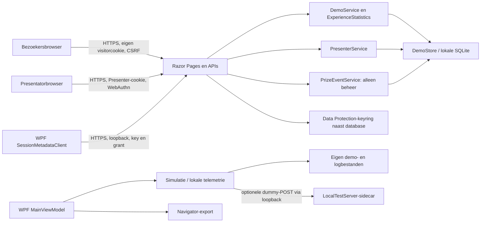
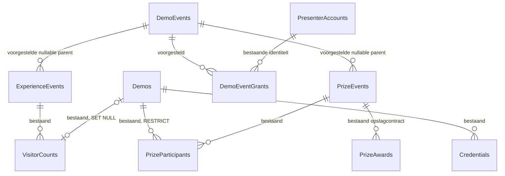
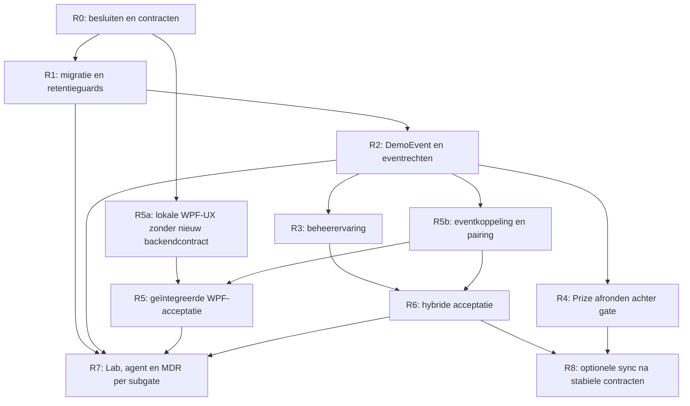

# Architectuurreview en implementatieplanning — volgende ontwikkelfase

> Consolidatie 1 november 2026: [het lifecycleontwerp](phase5-event-lifecycle-design.md) K01–K23 en [het integratieplan](phase5-event-integration-plan.md) zijn leidend voor de nieuwe doelarchitectuur. Onderstaande bronreview en implementatiestatus blijven historische context; eerder open A/C-, scheduler-, run-cardinaliteits-, hybrid Prize-, archief- en retentiehoofdkeuzes zijn daar nu besloten. Dit wijzigt de beschreven oude bron niet en verleent geen migratie-/runtimevrijgave.

Datum: 31 oktober 2026. Status: **analyse en ontwerpvoorstel; geen implementatie of operationele vrijgave**.

Bronbaseline: `a1d30fd584acfa5091cf4fe58a83611f66346086`. Vooraf waren lokale `main`, `origin/main` en de rechtstreeks uit GitHub gelezen `refs/heads/main` gelijk; index en werkboom waren schoon. Daarna is `analysis/phase5-architecture` aangemaakt. Uitsluitend dit rapport wordt op die branch gecommit; geen push of merge.

## 1. Managementsamenvatting

LummaSimulator heeft twee zelfstandige .NET 10-applicaties: een Windows WPF-simulator met begrensde lokale telemetrie, en een ASP.NET Core Razor Pages-portal met SQLite en echte WebAuthn-verificatie. WPF gebruikt geen portaldatabase. De optionele Session Exposure Monitor haalt uitsluitend lokale, expliciet vrijgegeven metadata op. Het bestaande sidecarproces ontvangt alleen synthetische loopbacktelemetrie en is geen externe agent.

De code bevestigt Prize-opslagfundament **5.1** en beschermd evenementbeheer **5.2a**. Deelnemersregistratie **5.2b**, trekkingen, claimherstel, uitgifte, realtimepresentatie en integrale purge zijn niet geïmplementeerd. Aanwezige tabellen voor deze functies zijn opslagcontracten. Een Open PrizeEvent is nog geen ingeschakelde Prize Experience: de beheerlaag forceert `PrizeEnabled=false`.

De belangrijkste gezamenlijke basis bestaat uit drie onderdelen:

1. Een overeengekomen DemoEvent-contract dat statistiekevenementen, PrizeEvents en optionele demoruns verbindt, met behoud van alle bestaande identifiers en historische tellingen.
2. Server-side rechten per evenement, boven op bestaande persoonlijke passkeyaccounts. De huidige rollen Administrator en Presenter zijn installatiebreed; iedere geldige presentator mag momenteel ieder PrizeEvent beheren. Dit is het bestaande gedeelde beheercontract, geen reeds gerealiseerd tenantmodel.
3. Eén retentiebeleid en één transactionele beslissing voor alle accountverwijderpaden. Anders botsen toekomstige Prize-deelnemers met directe deletes, credentialcascades en de bestaande accountcap.

Advies: eerst contracten/besluiten, vervolgens migratie- en retentiefundament, daarna eventrechten en beheerinterface. WPF-UX en deploymentdiagnostiek kunnen na vastlegging van contracten deels parallel lopen. Publieke Prize-activering wacht op de volledige deelname-, herstel-, claim-, retentie- en publicatieketen. Externe pairing, Detection Lab, agent en synchronisatie zijn afzonderlijke latere pakketten; geen reden om de bestaande loopbackgrenzen nu te verruimen.

Een klein nieuw overkoepelend eventregister is een onderbouwd voorstel, geen definitief besluit. Uitbreiding van bestaande tabellen is eerst onderzocht in §6. De reden voor een eventueel nieuw register is de verschillende identiteit, levensduur en concurrency van de bestaande eventmodellen. Geen historische gebeurtenissen achteraf automatisch samenvoegen op naam of datum.

### 1.1 Bewijskracht en geraadpleegde context

Dit rapport berust op statische broninspectie, Git-controles en primaire technische documentatie. Niet uitgevoerd: applicatiestart, build, regressierun, databasequery, migratie, processtop, package-installatie, configuratiewijziging, deployment, hardwaretest of toegang tot externe archieven. De operationele databaseversie, werkelijk gebruikte runtime-overrides, DNS, certificaten, wifi en actieve processen zijn daarom **niet vastgesteld**.

Gelezen en vergeleken: [AGENTS.md](../../AGENTS.md), [README](../../README.md), [functionele requirements](../functional-requirements.md), [v0.5-ontwikkelhistorie](../LummaSimulator-v0.5.md), [hybride requirements](hybrid-deployment-requirements.md), [Prize-functioneel](../phase5-prize-experience-functional.md), [Prize-architectuur](../phase5-prize-experience-architecture.md), [Prize-implementatieplan](../phase5-prize-experience-implementation.md), [eerdere UX-impactanalyse](../phase5-ux-modernization-impact-analysis.md) en relevante securitydocumenten onder `docs/security`.

De eerdere UX-analyse beschreef nog geen Git/AGENTS-baseline; dat deel is achterhaald. Het security-assurancerapport betreft bron na 5.1 en is geen actuele complete audit van 5.2a. De recente build-/regressieresultaten in [het Git-rapport](../git-setup-report.md) zijn eerder uitgevoerde controles, geen nieuwe resultaten van deze analyse. Toekomstige eisen, historische checkpoints en hieronder voorgestelde services worden consequent onderscheiden van aangetroffen code.

## 2. Huidige architectuur

### 2.1 Componenten, verantwoordelijkheden en afhankelijkheden

Paden hieronder zijn relatief aan de repositoryroot. Genoemde methoden zijn bronankers; toekomstige bestandsnamen worden expliciet als voorstel aangeduid.

| Onderdeel | Bronbestanden en methoden | Verantwoordelijkheid en afhankelijkheden |
| --- | --- | --- |
| WPF-presentator | `LummaSimulator.App/MainWindow.xaml`, `MainWindow.xaml.cs`, `MainViewModel.cs`: `Start`, `BeginSession`, `RunAsync`, `ShutdownAsync`; `Infrastructure.cs`, `Models.cs` | MVVM, zes vaste fasen, start/stop/reset, timing, modus, expliciete handmatige productbeoordeling en shutdown. Nieuwe eigen DemoRunId bij Start. Geen centrale eventselectie of gedeelde bedieningseigenaar. |
| Simulatie en JSON | `LummaSimulator.App/Services.cs`: `SimulationService.ExecuteAsync`, `JsonLogService.SaveAsync` | Vaste fictieve berichten; snapshots via tijdelijk JSON-bestand en vervanging. Ook SAFE schrijft echte logbestanden. Afhankelijk van `RuntimePaths`, geen portal. |
| Lokale telemetrie | `LummaSimulator.App/TelemetryService.cs`: `ExecuteAsync`, `RunProcessAsync`, `SendLoopbackAsync`, `EnsureSafePath`, `CleanupAsync` | Zichtbare `whoami.exe` zonder uitvoercapture, eigen synthetische bestanden, exacte dummyvalidatie, optionele HTTP-POST. Geen echte browseruitlezing. Cleanup is echt, begrensd en niet-recursief. |
| Sidecar | `LummaSimulator.App/LocalTestServerManager.cs`: `ConfigureAsync`, `StartInfo`, `StopOwnedAsync`; `tools/LummaSimulator.LocalTestServer/Program.cs`: `HandleAsync`; `shared/LocalTestServerProtocol.cs` | IPv4-loopbackreceiver, identity/nonce/PID/instancecontrole, private stdin-lease; alleen eigen gestart proces stoppen. Gebruikt apphost naast WPF, geen SDK tijdens runtime. |
| Build-/padcontract | `shared/LocalTestServer.Build.targets`, `shared/RuntimePaths.cs`: `Resolve`, `DataRoot`, `Logs`, `Exports`; beide appprojectbestanden | Linked source, geen gedeelde runtime-datalaag. Sidecar is transitieve projectreferentie; build kopieert helper, publish volgt RID/self-containedmodus. |
| Webcompositie | `LummaSimulator.Web/Program.cs` | DI, Razor Pages, minimal APIs, lokalisatie, cookies, policies, antiforgery, rate limits, exacte HTTPS-origin, headers, trusted proxies, startupmigratie en cleanup. Afhankelijk van alle portalservices. |
| Bezoekers | `Services/DemoService.cs`: `CreateAsync`, `OwnedCoreAsync`, `OptionsAsync`, `VerifyAsync`, `EndOwnAsync`, `CleanupCoreAsync`; `Pages/Index.cshtml.cs`, `Demo.cshtml.cs`, `Complete.cshtml.cs`; `Models/DemoModels.cs` | Cookiegebonden tijdelijke accounts, routekeuze, maximaal vijf passkeys, authresultaat, nieuwe bezoeker en einde. Bezoekers zijn geen Presenter-principal. |
| Opslag | `Services/DemoStore.cs`: `OpenAsync`, `InitializeAsync`, `InitializeLegacyAsync`, `AccountsAsync`, `CredentialsAsync` | Eén SQLite-database per portalinstallatie, ADO.NET, geen EF Core. Processpecifieke Gate; nieuwe connections met FK aan, pooling uit, secure_delete aan en 5 s busy timeout. |
| Statistiekevenementen | `Services/ExperienceStatistics.cs`: `InitializeAsync`, `CommitAuthenticationAsync`, `StartEventCoreAsync`, `CloseEventCoreAsync`, `SummaryAsync`; `Services/PresenterManagement.cs`: `EventAsync`, `RenameEventAsync` | Eerste bezoekersnummer, UTC-dagtellers, authentisaties en één actief statistiekevent. Database-transacties en index zijn gezaghebbend, niet alleen de Gate. |
| Persoonlijk beheer | `Services/PresenterAuthentication.cs`: `Actor`, `ValidateAsync`, `OptionsAsync`, `VerifyAsync`, `IssueBootstrapAsync`, `SetAccountAsync`, `RemoveKeyAsync`; `PresenterManagement.cs`, `PresenterEndpoints.cs`, `LocalMaintenance.cs` | Administrator/Presenter, discoverable login, accountsleutels, uitnodiging, herauthenticatie, sessieintrekking, lokale eerste-adminbootstrap en audit. Bestaande IFido2-library. |
| Beheerpagina's | `Pages/Presenter/Index.cshtml.cs`, `Accounts.cshtml.cs`, `Security.cshtml.cs`, `Audit.cshtml.cs`; `Program.cs` policies | Gedeelde dashboardinterface; extra adminpagina's en server-side servicechecks. Geen deploymenteditor, eventlidmaatschap of tijdelijke delegatie. |
| Prize Experience | `Models/PrizeModels.cs`, `PrizeEventModels.cs`; `Services/Prizes/PrizeMigration.cs`, `PrizeStore.cs`, `PrizeEventStore.cs`, `PrizeEventService.cs`, `PrizeAuthorization.cs`; `Pages/Presenter/Prizes/*` | Schema 6, profielen/snapshots, concept/start/sluit/heropen/hernoem/configureer/profielkopie. Actorcheck, CAS, idempotentie, audit/outbox. Geen bezoekersbusinesslaag. |
| Session Exposure Monitor | `Services/SessionStatusService.cs`: `Authorize`, `SetGrantAsync`, `GetAsync`; WPF `SessionMetadataClient.cs`: `FetchAsync`; `SessionMonitorViewModel.cs`: `ExecuteAsync` | Apart monitorgeheim, grant per demo, alleen loopbackmetadata. Exposure/replay is een fictief in-memoryobject na hercontrole. Geen echte sessieovername of serverrevoke vanuit WPF. |
| ATT&CK | `LummaSimulator.App/AttackMapping.cs`, `Models.cs`: `SimulationPhase.ConfirmAssessment`; `NavigatorExportService.cs`: `Appearance`, `CreateLayer`, `ExportAsync`; `docs/references/*` | Enterprise ATT&CK 20.0 en Navigator 4.5/layercontract, simulatie/uitvoering/observatie/detectie gescheiden. Allowlist-export zonder raw logs, accountnamen of vrije bewijstekst. Productdetectie is handmatig bevestigd, geen MDR-API. |
| Retentie | `DemoService` deletepaden; `SessionStatusService.GetAsync`; `Services/PresenterService.cs`: `CleanupWorker.ExecuteAsync`; `PresenterManagement.PurgeExpiredAsync`; WPF `TelemetryService.CleanupAsync` | Verspreide cleanup, geen centrale bewaarpolicy. Zie §7 voor data en neveneffecten. |
| Configuratie | `Configuration/WebAuthnSettings.cs`, `ExperienceSettings.cs`, `appsettings*.json`, `Properties/launchSettings.json`; WPF `DesktopSettings.cs`, settings-JSON | Omgevingsconfiguratie, validatie en padoverrides bestaan. Geen configuratieprofielenbeheer of veilige runtimewijzigingsworkflow. |
| Tests | `tests/LummaSimulator.RegressionTests/*.csproj`, `tests/LummaSimulator.Web.Tests/*`, `tests/WebAuthn.Ux.Tests/*`, `tests/LummaSimulator.SmokeTests/*`, `verification/*` | Eigen assertionrunners, softwareauthenticator/testklok, echte tijdelijke HTTPS-server/browserfixture, Node-tests, smoke/WPF en publishacceptatie. Geen vervanging voor hardware of operationele acceptatie. |

### 2.2 Routes en trust boundaries

- Bezoekerspagina's: `/`, `/Demo`, `/Complete`, `/Error`; einde/nieuwe bezoeker via POST. `POST /api/webauthn/{register|authenticate}/{options|verify|cancel}` vereist exacte Origin, antiforgery en operatie-ID. `POST /api/language` bewaart taal per publiek/presentator.
- Beheer: `/Presenter`, `/Presenter/Accounts`, `/Presenter/Security`, `/Presenter/Audit` en `/Presenter/Prizes`. Accounts/Audit hebben Administrator-policy; de Presenter-folder vereist Presenter-policy. Login/Enroll zijn de expliciete anonieme uitzonderingen.
- `POST /api/presenter/enrollment/open` en `/{kind}/{options|verify|cancel}` gebruiken eigen browser-/enrollmentbinding en Origin/CSRF. Beheeridentiteit verandert niet de CSRF-identiteit van een geopende bezoekerspagina.
- `GET /api/local/session-status/{demoRunId}` vereist aparte key en loopback; de service controleert de grant en sessietoestand. Een UUID alleen geeft geen toegang.
- `Program.cs` wist Presenter-principals buiten `/Presenter` en `/api/presenter`, met audience-uitzondering voor taal. Nieuwe beheer-API's of hubs moeten deze route-/authscope expliciet aanpassen; alleen `RequireAuthorization` toevoegen is niet voldoende als eerdere middleware de principal al heeft verwijderd.
- Verkeer naar een eventuele centrale portal, publiek presentatiescherm of externe agent is een nieuwe trust boundary. De bestaande monitorclient omzetten naar algemene remote toegang door loopbackchecks weg te halen is geen passend ontwerp.

### 2.3 Database en migratiearchitectuur

Dit is een inventaris van DDL in bron, geen uitlezing van een bestaande database.

| Groep | Tabellen en relaties | Levensduur/invariant |
| --- | --- | --- |
| Tijdelijke bezoekers | `Demos`, `Credentials`, `Challenges`, `MonitorGrants` | Demos bewaart account, DemoRunId, handle, sessiehash, route, timestamps, counters en ClosedAt. Credentials/challenges/monitorgrants hebben DELETE CASCADE naar Demos. |
| Statistieken | `ExperienceEvents`, `VisitorCounts`, `DailyExperienceStats`, `EventPrizePolicies`, `ExperienceMigrations` | Eén Active via `OneActiveExperienceEvent`; Imported/Closed blijven. VisitorCounts.DemoId is globaal UNIQUE en wordt bij accountdelete NULL; event/nummer en aggregaten blijven. EventPrizePolicies heeft expliciet Enabled=0/Awarded=0. |
| Beheer | `PresenterAccounts`, `PresenterKeys`, `PresenterAuthSessions`, `PresenterInvitations`, `PresenterEnrollmentGrants`, `PresenterCeremonies`, `PresenterAudit` | Accountrol CHECK alleen Administrator/Presenter; aparte credentials/sessies. Audit heeft NoUpdate/NoDelete-triggers. Geen eventmembership. |
| Legacy-auth | `PresenterSessions` | Historische gedeelde sessieopslag; geen vervanging voor huidige PresenterAuthSessions. Bestaande schemavorm bewaren. |
| Prize-configuratie | `PrizeProfiles`, `PrizeInstallationSettings`, `PrizeEvents`, `PrizeTypes`, `PrizeGroups` | Vier stabiele profielen, installatiebrede laatste profielkeuze, immutable configuratiesnapshot als ontwerpdoel; revisies en stock-/capaciteitschecks. |
| Prize-deelname | `PrizeParticipants`, `PrizeStartCodes`, `PrizeGroupCodes` | UNIQUE(EventId,AccountId/Number); deelnemer wijst RESTRICT naar Demos. Event/groep/codebinding via samengestelde FK's. Tabellen bestaan; deelnamebusinesslogica ontbreekt. |
| Prize-uitslagen | `PrizeDraws`, `PrizeDrawCandidates`, `PrizeInstantDecisions`, `PrizeAwards` | Opgeslagen draw Committed, planning/revealvelden, één eerdere winst per event/account via deelnemer; samengestelde FK's en unieke initial/replacementgrenzen. Geen operationeel drawalgoritme. |
| Prize-claims | `PrizeClaims`, `PrizeClaimSecrets`, `PrizeClaimData`, `PrizeInventoryLedger` | Status-/voorraadcontract, protected payload/tokenvelden en ledger; geen geleverde claimafhandeling of verwerking van claimpersoonsgegevens. |
| Prize-presentatie/herstel | `PrizePresentationGrants`, `PrizePresentationSessions`, `PrizePresentationSessionGrants`, `PrizeVisitorSessions`, `PrizeVisitorCeremonies` | Opslag voor beperkte sessies/capabilities; accountbinding RESTRICT, alleen specifieke sessie/grantkoppelingen CASCADE. Geen actieve presentatie-/recoveryroutes. |
| Prize-operaties/bewijs | `PrizeOperations`, `PrizeCreationOperations`, `PrizeAudit`, `PrizeOutbox`, `PrizeSchemaContract` | Idempotentie, revisions/audit/outbox bij beheerwijziging. Geen outboxpublisher. Schemafingerprint voor versie 6. |

Prize voegt 26 tabellen en acht expliciete indexen toe. De basis bevat daarnaast 17 applicatietabellen; SQLite-interne objecten zoals `sqlite_sequence` zijn geen eigen domeinmodel. Niet alle schema-invarianten zijn al bedrijfsregels: een tabel voor claims bewijst geen autorisatie-/deadline-/purgeketen.

`DemoStore.InitializeAsync` voert eerst `PrizeMigration.PreflightAsync` uit. Bestaande bekende versie 5/6 slaat de legacy-initialisatie over. Legacy maakt de basis aan en behandelt oudere kolomvormen; statistiekmarker 3 importeert eerder geslaagde accounts eenmalig, marker 4 introduceert persoonlijk beheer, marker 5 maakt `PresenterCeremonies.AccountId` nullable voor discoverable login. `PrizeMigration.Version=6` maakt het Prize-fundament met manifest/fingerprint.

**Belangrijk voor iedere volgende migratie:** `PrizeMigration.Validate` accepteert uitsluitend de expliciete histories leeg/3/3,4/3,4,5/3,4,5,6 en exacte bekende schemaobjecten. Een extra kolom, tabel, index of trigger kan startup al vóór de volgende migratie blokkeren. Nieuw werk vereist een versiegestuurde preflight/dispatcher vóór de oude exacte check; niet simpelweg een `ALTER TABLE` onderaan toevoegen of de v6-fingerprint overschrijven. Historische v5/v6-contracten en hersteltests blijven behouden.

## 3. Bestaande functionaliteit en actuele status

| Functie | Status | Concrete onderbouwing en grens |
| --- | --- | --- |
| Zelfstandige WPF-demo | Aanwezig | MainViewModel/SimulationService/TelemetryService; zes vaste fasen. SAFE/LIVE expliciet, HTTP apart uit. |
| Persistente WPF-voorkeuren en sessiecatalogus | Gedeeltelijk | DesktopSettings leest bestand/omgeving; geen algemene voorkeurenschrijver, automatische startup-run of historische sessieselector aangetroffen. |
| Bezoekerspasskeys | Aanwezig | DemoService.OptionsAsync/VerifyAsync; max vijf, resident key/UV Required, IFido2, single-use challenge, counters/backupflags. Cookieverlies geeft nog geen algemene bezoekersherstellogin. |
| Naamloze persoonlijke beheerlogin | Aanwezig | PresenterAuthentication.OptionsAsync/VerifyAsync; credentiallookup alleen PresenterKeys, vereiste handle, accountstatus en eigen herauthbinding. |
| Beheerrollen | Aanwezig, beperkt | Administrator/Presenter; admin krijgt beide claims. Geen systeem-/eventadminonderscheid of delegatie. |
| Evenementstatistieken | Aanwezig | ExperienceStatistics, één actieve context, duurzame tellingen en UTC-dagaggregaten. Geen generiek DemoEvent. |
| Prize 5.1 | Aanwezig als opslag | PrizeMigration/PrizeStore; versie 6, constraints, defaultprofielen en transactionele conceptcreatie. |
| Prize 5.2a | Aanwezig | PrizeEventService en beheerpagina's; lijst 25, concept/start, revisies, close/reopen, configuratie, profielkopie. Alle presenters delen beheer. |
| Prize publiek | Ontbrekend | Geen deelname-, draw-, claim-, herstel-, realtime-, QR- of rapportageketen. PrizeEventService.Validate normaliseert PrizeEnabled naar false; globale activatie faalt gesloten in ExperienceSettings.Validate. |
| Monitor en sessierisicouitleg | Aanwezig als simulatie | Fictief sandboxobject, geen cookie-export; servermetadata is momentopname. Refresh vóór exposure/replay, geen echte endpointrespons of containment. |
| MITRE-export/productstatus | Aanwezig | Mapping/allowlist-JSON; expliciete handmatige bevestiging. JsonLogService kan `edrDetectionConfirmed` uit zulke beoordelingen afleiden: dit is geen automatisch gemeten detectie. README-tekst die het veld steeds false noemt is te absoluut voor de huidige code. |
| Retentie | Gedeeltelijk | Tijdelijke accounts/ceremonies worden verwijderd; geen integrale export-/audit-/Prize-/backupretentie. Zie §7. |
| Mobiel/offline gebruik | Gedeeltelijk/onzeker | Lokale assets en apparaatroute-uitleg bestaan. Echte wifi, vertrouwde HTTPS, offline providerwerking en fysieke sleutelcompatibiliteit niet vastgesteld. |

### 3.1 Subtiele bestaande eventsemantiek

`ExperienceStatistics.CommitAuthenticationAsync` kent een bezoekersnummer alleen toe als nog geen VisitorCounts-rij voor het account bestaat. Bij latere authenticatie wordt de teller van het **dan actieve** statistiekevent verhoogd, terwijl de receipt het event uit de oorspronkelijke VisitorCounts-koppeling teruggeeft. Een account dat een eventwisseling overleeft kan dus in een ander authenticatie-aggregaat meetellen dan zijn oorspronkelijke bezoekersnummercontext. Dit is een bronvaststelling, geen nieuwe runtimeproef of stilzwijgende bugfix. Beslis expliciet over toekomstige semantiek; bestaande aggregaten niet herberekenen alsof per-authenticatiehistorie beschikbaar is.

WPF `MainViewModel.BeginSession` en portal `DemoService.CreateAsync` genereren onafhankelijk een DemoRunId. Het Navigator-exportcontract kan beide identifiers afzonderlijk opnemen. Eenzelfde veldnaam bewijst geen gedeelde run of gebeurtenis; een nieuwe pairing-/correlatiekoppeling moet dat expliciet vastleggen.

## 4. Ontbrekende functionaliteit en technische afhankelijkheden

De functionele requirements bevatten een veel bredere volgende fase dan Prize 5.2b. De volgende onderwerpen zijn niet als gerealiseerd te behandelen:

- DemoEvent, eigendom/delegatie, dashboardselectie van laatste toegankelijke event en server-side eventscope ontbreken. De roluitbreiding is een wijziging van bestaand gedeeld Prize-beheer; eerst besluit en compatibiliteitsbeleid.
- Beheerportaal voor retentie, policies, integraties en deploymentstatus ontbreekt; bestaande Accounts/Security/Audit/Prizes zijn wel een herbruikbare navigatiebasis.
- Centrale retentieservice, duurzame bezoekersclaimbinding en cookie-onafhankelijk passkeyherstel ontbreken. Harde afhankelijkheid vóór Prize-inschrijving.
- WPF Intro/Simulator/Resultaten-navigatie, animatie, aanvalsschema, filterbare gecorreleerde tijdlijn, monitorselectie, thema's en sessiecatalogus ontbreken of zijn slechts bestaande fasekaarten/logs. Geen algemene remote bedieningslaag of exclusieve eigenaarlease.
- Interactieve phishingdemo op tweede eigen RP-ID/domein en een echte geïsoleerde tweede-browsersessiedemo ontbreken. Geen toegang tot echte bestaande browsercookies nodig of toegestaan.
- Detection Lab, modulebibliotheek/scenario-editor, remote agent, mDNS-pairing, service-installatie, ondertekende module-updates, MDR-API-connectors, leveranciersvergelijking en PDF-rapportage ontbreken.
- Multi-installatiesynchronisatie ontbreekt. Eén lokale SQLite-database per portal blijft de huidige architectuur; geen netwerkshare of centrale database direct vanuit WPF.

### 4.1 Afhankelijkheden die behouden blijven

Portal: `Fido2.AspNet` 4.3.1 en `Microsoft.Data.Sqlite` 10.0.14 volgens csproj/lockfiles; WPF en sidecar hebben geen eigen externe packagebasis nodig. Geen package-upgrade voorgesteld als onderdeel van deze analyse. SignalR-/QR-clientdistributie is nog een expliciet dependency-/licentiebesluit; de bestaande frameworkhost is geen reeds aangesloten hub. Geen nieuw testframework nodig.

Geen projectverplaatsing of nieuwe gedeelde databaseassembly nodig. Nieuwe domeinservices kunnen eerst binnen de bestaande Web-assembly onder `Services` worden toegevoegd. Kleine DTO-contracten voor optionele WPF-HTTPS-koppeling kunnen later expliciet worden geversioneerd; linked source in `shared` is geen toestemming om portalbusinesslogica met WPF te vermengen.

## 5. Autorisatie en administratorportaal

### 5.1 Bestaande authenticatie en controles

De bezoekerscookie bevat een willekeurig geheim waarvan de database de hash bewaart. Passkeyregistratie en assertionverificatie gebruiken de bestaande IFido2-library, verplichte UV, specifieke accountcredentials en RP/origin-/challenge-/signature-/handle-/counter-/backupchecks. De challenge wordt vóór verificatie verbruikt. Visitorcookie en Presenter-cookie zijn gescheiden Secure/HttpOnly/Strict cookies.

`PresenterService.Actor` leest in een SQLite-transactie de werkelijke actieve account, sessiehash en sessie-expiratie; vertrouwt dus niet alleen op rolclaims. Gevoelige account-/sleutelacties vragen verse herauthenticatie van maximaal vijf minuten; de marker wordt voor de betreffende transactie verbruikt. Sessies duren geconfigureerd 5–30 minuten zonder sliding. `SetAccountAsync` trekt accountsessies/uitnodigingen/ceremonies in en beschermt de laatste actieve administrator; `RemoveKeyAsync` beschermt de laatste sleutel en trekt accountsessies in.

`IssueBootstrapAsync` kan alleen vóór een ooit geactiveerd account, via de lokale onderhoudsprocedure. `LocalMaintenance.RequireAdministrator` verifieert OS-beheerbevoegdheid; bootstrap-enrollment vereist directe loopback zonder forwarded headers. Uitnodigings-/enrollmentcodes verlopen na tien minuten en worden vervangen/verbruikt. `InviteAsync` biedt beheerd opnieuw enrollen; reservesleutel en een tweede bevoegde administrator zijn bestaande herstelbouwstenen. Een complete last-admin-lost-keys recoverywizard bestaat niet; bootstrap opnieuw openzetten is geen veilige fallback.

### 5.2 Gewenste rollen: minimale uitbreiding

| Gewenste rol | Huidige basis | Voorgestelde betekenis en grens |
| --- | --- | --- |
| Systeemadministrator | Administrator | Installatiebreed account-/securitybeheer en expliciet geautoriseerd deploymentbeheer. Bestaande rol kan technisch blijven heten Administrator; geen verplichte herbouw van Role-CHECK voor een nieuw label. |
| Evenementadministrator | Niet aanwezig | Eventgebonden bevoegdheden op bestaande PresenterAccount: leden, policies, sluiting/retentie en integraties binnen een expliciet event. Geen systeem- of RP-ID-beheer. |
| Presentator | Presenter | Operationele eigen/toegewezen events en toegestane demonstraties/Prize-acties. Geen impliciete toegang tot ieder nieuw event. Welke eventcreatierechten gelden is nog te besluiten. |
| Gedelegeerde presentator | Niet aanwezig | Tijdgebonden grant op event/capabilities, geen nieuwe globale loginrol. Begrensde geldigheid, expliciete issuer, revocation en audit; geen transitieve door-delegatie als standaard. |
| Bezoeker | Eigen Demos/visitorcookie | Alleen eigen demo; toekomstige beperkte claim-/recoverysessie. Geen Presenter-account of gedeelde beheerclaims. |

Voorstel: behoud de twee bestaande globale rollen; modelleer EventAdministrator/Presenter via eventlidmaatschap en delegatie als tijdelijke capability. Dat voorkomt dat een globale rolkolom onterecht toegang geeft tot alle events. Een extra rol is alleen nodig als er een aantoonbaar afwijkende bevoegdheid bestaat; bezoekers hoeven geen rol in PresenterAccounts te krijgen.

Voor een N:M-relatie volstaat een extra OwnerId op een event niet. Na het eventbesluit is een kleine `DemoEventGrants`-tabel gerechtvaardigd: EventId, PresenterAccountId, toegestane capability/rol, GrantedBy, ValidFrom, ExpiresAt?, RevokedAt?, revisie en auditreferentie. Of eigenaar een veld op de eventparent of een unieke grant is, blijft een expliciete implementatiekeuze. Identiteit blijft uit PresenterAccounts; geen parallel gebruikersregister.

### 5.3 Server-side afdwingen

Een voorgestelde `EventAuthorizationService` moet voor iedere read én mutatie de bestaande `Actor` valideren en eventlidmaatschap/capability toetsen. Mutaties doen dat in dezelfde connection/transaction als de bedrijfsactie, vóór idempotentieresultaten of objectinhoud worden teruggegeven. Revocation heeft dan ook effect op een oude geldige retry. Event-ID in route/form/DTO is een scopekeuze, geen bevoegdheid.

Pas filters toe vóór paginering/tellers/export, op detailqueries, demo-end, monitorgrants, profielcontext en toekomstige claims/presentatie. Controleer de gehele keten DemoEvent → PrizeEvent → child. Bestaande samengestelde Prize-FK's blijven hun eigen EventId controleren; deze ID niet vervangen door het overkoepelende ID. Een systeemadmin-bypass is expliciet, gelogd en alleen voor benoemde acties; evt. claim-PII-toegang blijft afzonderlijk bevoegdheidsbesluit.

Nu valideert `PrizeAuthorization.RequireActorAsync` alleen de installatiebrede actorrol; er is geen eventparameter. De huidige dashboardhandlers schrijven een actie-aanvraag in `RecordDemoActionAsync` en voeren demo-end/monitorgrant vervolgens via een andere service/connection uit. Dat is een aandachtspunt voor de nieuwe eventgrens: controle, mutatie en geslaagde audit moeten transactioneel bij elkaar komen. De huidige auditnaam Requested mag niet als bewijs van een geslaagde delete worden geïnterpreteerd.

### 5.4 Audit, recovery en fysieke YubiKey

Behoud append-only PresenterAudit. Voeg voor eventacties minimale actor-, event-, actie-, target-, resultaat-, tijd- en correlatiegegevens toe, zonder namen, codes, cookie-/credentialmateriaal of claiminhoud in auditpayloads. Bestaande PrizeAudit heeft eventscope, maar dezelfde append-only triggers als PresenterAudit zijn niet aangetroffen; onveranderlijkheid is deels nog toekomstig bedrijfscontract. Geen WORM- of onafhankelijke bewijsclaim.

De huidige `AttestationPreference.None`/`RequireNone` kan geen fysieke YubiKey afdwingen. UV, discoverable credentials, backupflags of een browserknop bewijzen geen merk/model of hardwaretype. De nieuwe fysieke-admineis vraagt een afzonderlijk ontwerpbesluit: gecontroleerd provisioningproces met expliciete bewijskracht, of cryptografisch onderbouwd attestation-/metadata-beleid via de bestaande library met vertrouwde roots, modellen, intrekkings- en offlinebeleid. Dat is een bewuste wijziging van het huidige privacy-/attestationbeleid; niet stilzwijgend op alle bezoekers toepassen. Bestaande admincredentials niet achteraf als hardwareverified markeren. [WebAuthn-specificatie](https://www.w3.org/TR/webauthn-3/).

Recovery hoort hetzelfde beveiligingsniveau te houden: tweede geregistreerde sleutel, tweede systeemadministrator, auditeerbare gecontroleerde uitnodiging en apart break-glass-besluit bij totaalverlies. Geen wachtwoordfallback, reset van RP-ID of verwijderen van passkeys/keyring. Hardwareaanpassing mag pas verplicht worden na fysieke primaire/reservesleutel- en herstelacceptatie, zonder bestaande toegang onverwacht af te sluiten.

### 5.5 Beheerinterface: twee soorten instellingen

| Deploymentbeheer | Applicatiebeheer |
| --- | --- |
| Publieke canonical URL, RP ID, Origins, AllowedHosts, HTTPS/listener/proxytrust, opslag/databasepad, keyringcontext, certificaatstatus en hostingstatus | Events, presentatoren, eventgrants/delegaties, retentiepolicies, profiel-/demo-instellingen, expliciet gepairde integraties |
| Eerste stap alleen geredigeerde statusweergave en configuratievalidatie; geen algemene schrijfbare settingspagina | Beveiligde Razor Pages boven bestaande services; systeemadmin voor globale accounts, eventadmin voor goedgekeurde eventacties |
| Wijzigingen later via voorbereid voorstel met impactanalyse, verse adminauth, hardwarebeleid, expliciete bevestiging, versie/conflictdetectie, audit, onderhoudsplan en rollback | Per wijziging validatie, audit, versie/idempotentie, scopes en waar nodig verse auth |
| Certificaatprivate keys, raw connection secrets en monitor-/pairinggeheimen nooit tonen of exporteren | Geheimen apart opslaan en alleen verwijzen; publieke configuratie en secrets niet als één formulier behandelen |

RP-ID/originwijziging kan bestaande credentials onbruikbaar maken. Databasepadwijziging kan een lege andere database en keyring openen en ten onrechte bootstrap mogelijk laten lijken. De oude data zijn daarmee niet gemigreerd. Deploymentwijzigingen daarom als gecontroleerde installatiehandeling behandelen; geen runtime-save die stilzwijgend restart of dataverplaatsing veroorzaakt. Kies later wie OS-/servicebeheer mag uitvoeren; applicatierol is geen automatische OS-beheertoestemming.

## 6. DemoEvent en voorgestelde doelarchitectuur

### 6.1 Bestaande relaties eerst benutten

| Relatie | Huidige bron van waarheid | Wat niet mag worden afgeleid |
| --- | --- | --- |
| Account → eerste statistiekevent | `VisitorCounts.DemoId/EventId` | Geen volledige bezoekgeschiedenis of unieke deelname per toekomstig DemoEvent. |
| Statistiekevent → huidige presentatiecontext | `ExperienceEvents.Status='Active'` | Geen generiek evenement met meerdere gelijktijdige activiteiten. |
| Prize-deelname → account/event | `PrizeParticipants.AccountId/EventId` | Geen andere accounttabel nodig; account kan meerdere PrizeEvents hebben. |
| PrizeEvent → maker | `PrizeCreationOperations.ActorId` en PrizeAudit | Maker is geen bewezen huidige eigenaar of delegatie. |
| Presentator → statistiekevent | PresenterAudit van start/sluit/rename | Auditactie verleent geen duurzaam eventrecht. |
| WPF-run → portalrun | Handmatige `PortalDemoRunId`; Navigator bewaart beide | Geen gedeelde identiteit of eventmembership uit naam-/UUID-gelijkheid. |

### 6.2 Afweging uitbreiden versus nieuw register

| Variant | Mogelijke uitbreiding | Voordeel | Bezwaar/voorwaarden |
| --- | --- | --- | --- |
| A: ExperienceEvents als DemoEvent | Voeg metadata, eigendom/revisie en optionele PrizeEvent-koppeling toe; presenteer als DemoEvent | Minste nieuwe identiteitslaag; statistiekreferenties blijven | De bestaande CHECK Active/Closed/Imported en unieke actieve index horen bij statistiekvensters. Meerdere gelijktijdige overkoepelende events vereisen een afzonderlijke lifecycle of wijziging van bestaande semantiek. Purge van tijdelijke Prize-data mag duurzame statistiek niet verwijderen. Niet vanzelf een volledig eventmodel. |
| B: PrizeEvents als DemoEvent | Maak overige demo's via nullable koppelingen onderdeel van PrizeEvent | Beheer-/snapshot-/retentievelden bestaan al | Prize is optioneel; Draft/Open/Closed/Purging, claimdeadlines en voorraad zijn modulespecifiek. Zou alle demo's aan Prize-lifecycle binden en bestaande FK-/fingerprintcontracten raken. Ongewenste standaardbasis. |
| C: dunne nieuwe DemoEvents-parent | Breid ExperienceEvents en PrizeEvents alleen uit met nullable DemoEventId; behoud alle lokale IDs/semantiek | Verbindt verschillende lifecycles, optionele modules en meerdere gelijktijdige events; historische data blijven zelfstandig | Eén nieuwe parent plus expliciete backfill/ownerbesluiten; extra mapping en consistente scope nodig. Niet beginnen zonder cardinaliteitsbesluit. |

**Aanbevolen voorstel C**, indien het doel werkelijk meerdere gelijktijdige overkoepelende evenementen omvat. Bestaande tabellen blijven moduleaggregaten; geen duplicatie van visitors, credentials, prizes of statistiek. Als product bevestigt dat DemoEvent uitsluitend de bestaande ene actieve statistiekcontext betekent, kan A kleiner zijn. Dit beslispunt moet vóór de migratie worden vastgesteld; deze analyse kiest het niet als geïmplementeerd ontwerp.

Voor C is de minimale parent een stabiele UUID, naam, lifecycle, created/closed timestamps, revisie en policyverwijzing/snapshot. Concrete lifecyclewaarden, geplande events en eigenaarsemantiek zijn nog open. Niet alle PrizeConfiguration-kolommen naar DemoEvents kopiëren. Een DemoEvent mag nul of meer statistiekvensters en nul of meer PrizeEvents bevatten; maximaal één parent per module-event is een te bevestigen voorstel. Geen globale unieke Active-index op DemoEvents; de bestaande statistiekindex blijft ongewijzigd.

### 6.3 Uitbreidingen en historie

1. Eerst leesmodel/DTO `DemoEvent` ontwerpen met expliciet onderscheid tussen overkoepelende ID, ExperienceEventId, PrizeEventId, PortalDemoRunId en SimulatorDemoRunId. Geen clientcode die één willekeurige `EventId` voor alle vijf gebruikt.
2. Nullable parent-FK's toevoegen aan bestaande ExperienceEvents/PrizeEvents; oorspronkelijke IDs en alle historische FK's blijven. Legacy-rijen mogen voorlopig ongekoppeld blijven. Geen match op titel/tijdstip en geen impliciete eigenaar op basis van audit.
3. Voor nieuwe events parent en gewenste module-event(s) atomair aanmaken. Mutaties naar bestaande module-ID blijven via adapter bruikbaar; nieuwe API's zijn geversioneerd, niet dezelfde response stilzwijgend anders invullen.
4. Nieuwe gekoppelde portalruns kunnen een nullable DemoEventId op Demos krijgen als dit de context van die ene run betekent. Het veld is **niet** het lidmaatschap van het account voor alle PrizeEvents. Dat blijft N:M via PrizeParticipants. Beslis eerst of account en run later worden ontkoppeld; nu geen duplicerende Visitors-tabel voorstellen.
5. WPF bewaart optionele event-/correlatiecontext lokaal en werkt zonder netwerk. Een UUID bewijst geen servertoegang. Upload/koppeling uitsluitend na pairing en server-side eventautorisatie; geen directe database-FK vanuit een WPF-bestand.
6. Historische WPF-logs worden niet herschreven of automatisch geïmporteerd. Een latere import maakt een aparte geautoriseerde verwijzing met herkomst, versie en onzekerheidslabel.

Een nieuwe run-/tijdlijntabel is pas nodig voor servermatig opvraagbare WPF-/labuitvoeringen, niet om de huidige portalrun te dupliceren. Begin met bestaande DemoRunId, Demos en JSON-contracten. Ontwerp later één append-only activiteitcontract met sequence/correlation en bewijsstatus; scheid dat van bestaande geaggregeerde statistiektabellen.

### 6.4 Eventisolatie en compatibiliteit

Eventisolatie heeft twee verschillende betekenissen: relationele integriteit binnen PrizeEvents bestaat deels al; toegangsisolatie tussen presentatoren/events ontbreekt. Beide testen. Een bovenliggend event-ID mag geen cross-event claim of prijsrelatie toestaan en geen overerving van een grant naar een ander event veroorzaken.

Historische ongekoppelde events blijven zichtbaar voor systeemadmins. Toegang voor bestaande presenters vraagt een expliciet overgangsbesluit: bijvoorbeeld reviewed grants per bestaand event, met audit. Geen permanente verborgen legacy-bypass en geen automatisch eigenaarschap voor de laatst schrijvende presentator. Intussen bestaande 5.2a-beheersemantiek behouden tot de nieuwe toegangsmodus als geheel kan worden ingevoerd. Gemengde oude/nieuwe writers op dezelfde database zijn niet toegestaan.

## 7. Retentie en gegevensverwijdering

### 7.1 Dataregister en bestaande acties

| Gegevens | Aanmaak/bewaring | Huidige intrekking/verwijdering | Toekomstige centrale policy |
| --- | --- | --- | --- |
| Bezoekersaccounts | DemoService.CreateAsync → Demos; willekeurige alias/handle en timestamps | OwnedCoreAsync verwijdert bij idle; EndOwnAsync en EndAsPresenterAsync direct DELETE; CleanupCoreAsync DELETE op LastSeen. Idle configureerbaar 1–29 min | Intrekken direct; fysieke delete alleen zonder noodzakelijke eventbinding. Niet-deelnemers behouden huidig gedrag. |
| Bezoekerspasskeys | Credentials, maximaal vijf per Demos; publieke keys/counters/backupflags, geen private key | Cascade bij accountdelete; geen onafhankelijke algemene passkeyretentie | Zelfde account-/bindingbeleid; behoud bytes/counters bij migratie, nooit kopiëren om lifecycle te omzeilen. |
| Nieuwe-bezoekeroverdracht | CreateAsync(previousToken) | Roteert oude SessionHash, zet ClosedAt, verwijdert challenges/grants; account en keys blijven tot idlecleanup. Cap telt eerst alle Demos, ook gesloten | Handoversessie onmiddellijk ongeldig; bewaarde deelnemer alleen via beperkte herstellogin. Actieve tijdelijke capaciteit en behouden accounts apart begrenzen. |
| Portalrun/authresultaat | Demos.DemoRunId, Successes/Failures/LastAuthenticatedAt | Onderdeel van accountdelete, geen aparte permanente runhistorie | Runmetadata minimiseren; access-expiry is geen automatische toestemming om claimbinding te verwijderen. |
| Statistiek/bezoekersnummer | VisitorCounts, ExperienceEvents, DailyExperienceStats | VisitorCounts.DemoId wordt NULL bij accountdelete; tellingen/events blijven | Aggregaten apart bewaren na beoordeling op herleidbaarheid. Geen historische tellingen reconstrueren uit verwijderde accounts. |
| Statistiek-/DemoEvents | ExperienceEvents; toekomstige parent nog niet aanwezig | Geen automatische eventpurge aangetroffen | Lifecycle en dataretentie scheiden; parent niet verwijderen zolang modules/benodigde audit ernaar verwijzen. |
| Prize-data | 26 tabellen; huidige writes vooral beheer/profielen/audit/outbox | Close legt PurgeAt eenmaal vast; Reopen bewaart grens; geen automatische Prize-purge of operationele deelnemersretentie | F08/A10-contract: deadline bij requests, daarna herstartbare purge; claims/PII/secrets/export/outbox/eventaudit mee. |
| Presenteraccounts/keys | PresenterAuthentication create/enroll, echte beheernamen/metadata | Disable trekt sessies in maar bewaart keys/account; keydelete expliciet, niet laatste sleutel | Doelgebonden account-/sleutelbeleid, geen bezoekers-idlebeleid. Permanent bewaren niet als vanzelfsprekend aannemen. |
| Authceremonies/sessies | Challenges, PresenterAuthSessions/Invitations/EnrollmentGrants/Ceremonies | Visitorcleanup en PresenterService.PurgeExpiredAsync; verval wordt ook bij gebruik getoetst | Korte geldigheid, consumed/revoked state, achterstallige cleanup veilig in batches. |
| Auditlogs | PresenterAudit, PrizeAudit; portal JsonConsole | PresenterAudit update/delete geblokkeerd door triggers; geen centrale auditrotatie. Prize-eventaudit heeft geplande purge, nog niet operationeel | Minimale noodzakelijke audit apart classificeren; bewaartermijn/eigenaar vastleggen. Triggerbeleid niet uitschakelen als generieke cleanupoplossing. |
| WPF-runs/demoartefacten | JsonLogService en TelemetryService: logs en drie bekende runbestanden | Clean demo files verwijdert alleen herkende eigen bestanden/mappen; logs blijven. Reset wist alleen UI | Lokale adapter met goedgekeurde roots, policy/eigendom/preview; geen globale recursieve purge. Stop/einde betekent nu geen automatische logdelete. |
| Monitorlogs | SessionMonitorViewModel schrijft per PortalDemoRunId een snapshotbestand | Overschrijft dezelfde snapshot; geen centrale verwijdering | Korte afzonderlijke retentie, geen onbedoelde audit-tijdlijnclaim. |
| Navigator/latere exports | NavigatorExportService.ExportAsync, unieke JSON-file | Geen automatische cleanup; niet gekoppeld aan portalpurge | Lokale/serverexports registreren en doel/retentie meegeven; downloads buiten server zijn niet op afstand wisbaar. |
| Backups/keyring | Operationele installatieopslag, keyring naast database | Geen automatische backuprotatie aangetroffen | Consistentie, beperkte toegang, bewaarbeleid en herstelcontext; geen generieke keyringpurge of wissen bij eventsluiting. |
| Detection Lab toekomst | Nog geen opslag | Niet aanwezig | Aparte policy voor bewijs/testhistorie versus herleidbare sessiecontext; anonieme technische historie pas na bewezen ontkoppeling. |

Automatische portalcleanup draait bij startup, via de worker iedere 30 s, tijdens accountcreatie en dashboardopvragen; OwnedCoreAsync werkt ook bij gewone account-/ceremonie-opvragen. **SessionStatusService.GetAsync verwijdert een verlopen account tijdens een GET**, ondanks de beperkte metadatafunctie. Die verwijdering moet eveneens naar de centrale beslisser. SetGrantAsync gebruikt de vaste IdleLifetime van 29 min, terwijl account-idle configureerbaar is en de monitor een 30-minuten-authstatusvenster hanteert; deze termijnen niet verwarren of ongemerkt gelijk trekken.

Bij toekomstige PrizeParticipants/PrizeVisitorSessions kan RESTRICT een bestaande DELETE laten falen. Dat voorkomt een cascade naar gebonden accounts, maar levert geen correcte revoke-/herstelervaring: worker- of gebruikersacties kunnen dan fouten geven. Niet oplossen door FK's uit te zetten, records te cascaderen of exceptions te negeren.

### 7.2 Centrale retentieservice: voorstel

Voorgestelde portallaag `RetentionPolicyService` berekent met TimeProvider een expliciete beslissing per gegevensklasse en reden: `RevokeAccess`, `Expire`, `RetainUntil` en `DeleteEligible`. Een `RetentionCoordinator` voert deadlines en herstartbare batches uit. Een Prize-adapter levert bestaande eventbindingsinformatie; WPF houdt een eigen lokale adapter. Eén policy-/besliscontract betekent geen gedeeld databaseproces voor beide applicaties.

Vier afzonderlijke acties:

1. **Toegang intrekken:** sessiehash roteren/revoken, challenges/monitorgrants onbruikbaar maken, toekomstige hub-/capabilitytoegang afsluiten. Onmiddellijk, ook als accountdata bewaard moeten blijven.
2. **Verlopen:** logische tijdgrens bij iedere gevoelige request afdwingen. Een stilstaande cleanupworker of offlineperiode verlengt geen toegang. Geen LastSeen-verlenging van vaste event-PurgeAt.
3. **Verwijderen:** pas na beleidsbesluit; in FK-veilige volgorde, begrensde transacties, idempotent en na crash hervatbaar. Bestandsverwijdering apart registreren; bestandssysteem en SQLite vormen geen gezamenlijke transactie.
4. **Noodzakelijke audit bewaren:** minimale niet-geheime acties/resultaten met vastgesteld doel, termijn en toegang; niet alle eventdata naar een onbeperkt archief verplaatsen.

Vóór iedere verwijdering van Demos moet dezelfde guard in dezelfde write-transactie nagaan of er nog PrizeParticipants/bewaarde sessiebindingen zijn. Ook geannuleerde/niet-winnende deelnames behouden de anti-herinschrijvingsbinding; alleen Pending claims controleren is onvoldoende. Meerdere events houden een account vast tot de laatste noodzakelijke binding weg is; een Open event zonder PurgeAt vraagt zichtbaar beheer, geen onbeperkt stilzwijgend privacylabel.

Alle genoemde deletepaden worden wrappers rond diezelfde operatie. Voorkom deadlocks door Gate niet opnieuw vanuit een reeds gelockte coremethode te nemen; geef bestaande connection/transaction door en definieer één lockvolgorde. Gebruik SQLite-transacties voor cross-connection-besluiten. Geen filesystem-, FIDO-dialog-, netwerk- of animatiewacht in een writertransactie.

Bij Prize-purge eerst access blokkeren, FixedPrizeTypeId-cycle gecontroleerd losmaken, kinderen/replacementreferenties in geteste volgorde verwijderen, accountbindings opnieuw beoordelen en pas daarna parent opruimen. De coordinator moet na crash verder kunnen en conflicts rapporteren. Exacte deletevolgorde en snapshotbewaring worden later als synthetische FK-tests vastgelegd, niet nu op een database uitgeprobeerd.

### 7.3 Policyconflicten die een besluit vragen

De algemene requirements noemen standaard verwijderen bij sessie-einde; Prize F08 verlangt behoud van expliciete deelnemers tot eventretentie (1–90 dagen, Cybertruck 30 dagen na sluiten). Voorstel: tijdelijke demos standaard huidig einde-/idlegedrag; afzonderlijke zichtbare opt-in voor Prize met eigen bewaardoel en herstel. Geen verbreding naar alle bezoekers en geen automatische nieuwe opt-in door alleen inloggen.

Twee minuten na bekendmaking is volgens Prize F07 een reactietermijn, geen automatische Expired/hertrekking. De definitieve claimgrens is apart en nooit later dan PurgeAt. Reopen verlengt de oorspronkelijke bewaarbovengrens niet en herstelt geen terminale claim. Centraal beleid moet deze modulebetekenis behouden.

PresenterAudit-triggers verbieden fysieke delete. Als een kortere auditretentie wordt gekozen, vraagt dat een afzonderlijk geversioneerd auditontwerp en privacybesluit; geen productie-trigger uitzetten voor cleanup. Wettelijke administratie alleen na expliciet vastgestelde noodzakelijkheid, gegevens en termijn; dit rapport verzint geen juridische bewaartermijn.

Backups kunnen verwijderde data terugbrengen. Na expliciet toegestane restore eerst verlopen toegang/deadlines en achterstallige cleanup controleren vóór verkeer. Oude database nooit over een actieve installatie terugzetten; consistente database/keyring in de oorspronkelijke DPAPI-context en fysieke uitgegeven Prize-voorraad reconciliëren. Serverdelete garandeert geen vernietiging van externe downloads, backups of SSD-restanten.

## 8. Hybride deployment

### 8.1 Wat configuratie nu ondersteunt

`WebAuthnSettings.Validate` accepteert een expliciete canonical DNS-host via Experience.Hostname, anders localhost in Development en de bestaande concrete deploymenthost in Production. RP ID moet exact overeenkomen. Origins zijn maximaal acht unieke canonical HTTPS-origins op dezelfde host; buiten Development alleen de standaardpoort. Dit is een striktere huidige productregel dan alle theoretische WebAuthn-mogelijkheden; niet ongemerkt verruimen voor een tweede domein.

`Program.cs` controleert iedere request op de geconfigureerde HTTPS-origin; AllowedHosts en trusted-proxyconfiguratie zijn aanvullende grenzen. ForwardedHeaders wordt alleen toegepast bij expliciete KnownProxies, ForwardLimit=1. TLS-terminatie vereist correcte proxytrust en publieke Host; geen onbeperkte trust van aangeleverde headers. De portal hoeft niet op localhost te blijven luisteren, maar een werkende centrale/offline productiesetup is niet uit bronconfiguratie alleen bewezen.

Databasepad is `Database:Path` indien ingevuld, anders `Storage:DataDirectory`/LUMMA_DATA_DIRECTORY plus PasskeyPortal/portal.db. RuntimePaths kan relatieve paden en environment-overrides verwerken. Keyring staat naast de gekozen database; op Windows wordt `ProtectKeysWithDpapi()` aangeroepen. Verplaatsen van data of service-identiteit kan sleutelontsleuteling breken. Op niet-Windows is wel beperkte Unix-toegang ingesteld maar geen expliciete encryptor at rest in deze code: hostingkeuze en sleutelbescherming moeten worden ontworpen, geen bestaande sleutelbestanden inspecteren om dit te bevestigen. [Data Protection en DPAPI](https://learn.microsoft.com/en-us/aspnet/core/security/data-protection/implementation/key-encryption-at-rest?view=aspnetcore-10.0).

### 8.2 Omgevingen en benodigde veranderingen

| Aspect | Development localhost | Centrale online hosting | Zelfstandige offline Cybertruck |
| --- | --- | --- | --- |
| URL/RP/origin | Bestaand Development-profiel, localhost:7243 via HTTPS; uitsluitend eigen synthetische data | Expliciet beheerde canonical host/RP/origin, AllowedHosts, publieke URL voor links, TLS en proxytrust | Bereikbare eigen host via lokaal DNS op wifi, passende RP/origin en vertrouwd certificaat; domeinstrategie nog open |
| Passkeys | Softwaretests plus fysieke devacceptatie; dev-RP staat los van productie | Normale IFido2, fysieke admins pas na gekozen beleid | Authenticator en browser moeten zonder cloud functioneren; op eigen apparaten en demo-laptops werkelijk testen |
| Data | Eigen tempdatabases/keyring per test | Eigen lokale database per portalinstance, persistent volume en service-identiteit; geen multi-host writers | Eigen lokale database/keyring; geen database delen met centrale installatie of WPF |
| Netwerk | Loopback is bewust onderdeel van fixtures | Ingress, trusted reverse proxy, TLS-status, admission/quotas en operationele monitoring | Wifi-clientisolatie/routing naar server, DNS, firewall, IPv4/IPv6, captive portal, systeemklok en capaciteit accepteren |
| Assets/dependencies | SDK/restore voor bouwen, lokale browserassets | Gepubliceerde runtime en assets, gekozen RID/runtimepatch; geen SDK in normale runtime | Alles vooraf lokaal aanwezig; geen runtime-CDN, MDS- of QR/SignalR-download; herstart met internet fysiek uit |
| WPF-monitor | Bestaand loopbackpad bruikbaar met key/grant | Momenteel onbruikbaar vanaf andere machine; afzonderlijk veilig remote contract/pairing nodig | Op dezelfde machine mogelijk met loopback-DNS; vanaf andere laptop nog geen ondersteunde koppeling |
| Logs/backup | Uitsluitend testscope, geen kopie actieve data | Minimaal geredigeerd, beperkte toegang/rotatie, consistente backup en geteste recovery | Lokale logs/exportquota en backup-procedure; offline sleutel-/certificaatverloop en vertraagde cleanup zichtbaar |
| Sync | Niet nodig | Later beperkte geautoriseerde uitwisseling | Offline blijft zelfstandig; sync optioneel, hervatbaar en nooit voor de basisdemo verplicht |

### 8.3 Concrete localhostafhankelijkheden

| Bron | Huidige beperking | Consequentie/ontwerpactie |
| --- | --- | --- |
| `Properties/launchSettings.json`, `appsettings.Development.json` | HTTPS localhost:7243 en dev-RP | Alleen ontwikkelprofiel; niet als wifi-/productieconfig kopiëren. |
| `LummaSimulator.App/DesktopSettings.cs`, app-settings | PortalOrigin default localhost | Alleen default wijzigen maakt remote monitor niet mogelijk. |
| `SessionMetadataClient` constructor en ConnectCallback | Allowlist localhost/bestaande host; DNS-adressen worden op loopback gefilterd; proxy/cookies/redirects uit | Voor externe portal is een nieuw gepaird metadata-contract nodig, geen algemene allowlistverruiming. |
| `SessionStatusService.Authorize` | Afzender-IP moet loopback zijn naast key/grant | Een centrale portal accepteert geen remote WPF. Proxy naar loopback maakt een client niet automatisch bevoegd; dreigingsmodel vereist. |
| `PresenterEndpoints.DirectLoopback`, LocalMaintenance | Eerste bootstrap via directe lokale verbinding en OS-beheercontrole | Bewuste veiligheidsgrens; externe adminwizard moet aparte veilige provisioning bieden. |
| `TelemetryService.SendLoopbackAsync`, sidecarlistener | Letterlijke IPv4-loopback en vaste synthetische payload | Behouden voor echte lokale telemetrie; dit is geen transport voor remote labs of portalintegratie. |
| Tests/RegressionTests | Loopback-origins, expliciete test-DLL en tempfixtures | Goede testisolatie, geen bewijs van mobiele productietoegang. |

Browser `localhost` op een telefoon verwijst naar die telefoon, niet naar de Cybertruckserver. Lokaal DNS geeft op zichzelf geen certificaatvertrouwen. Een bestaande dev-certificaattrust op één laptop bewijst niets voor bezoekersapparaten. Browser-/passkeyprovider/hybridmogelijkheden verschillen; geen offlinegarantie of hardwaretype uit routekeuze afleiden.

### 8.4 DNS/TLS en beheerprocedure

De vaste publieke naam met lokale DNS-resolutie is een onderzoeksrichting uit de hybride requirements, geen gekozen oplossing. Voor vertrek: domeinbeheer, resolver, certificaatketen/vertrouwen, private-keyopslag, vervaldatum, correcte klok, vernieuwing en herstel accepteren. Voor centrale en lokale installaties dezelfde RP gebruiken kan credentials in hetzelfde RP-bereik plaatsen; gedeelde origin/RP maakt databases of accounts niet identiek. Bestaande credentialstores blijven onafhankelijk; geen automatische passkeykopie.

Een tweede phishingdemo-RP vereist een afzonderlijke gecontroleerde host/TLS/RP-context met eigen demoaccounts en beperkte verifierconfiguratie. Geen brede extra Origins op de bestaande RP als vervanging voor een echte tweede RP-test. Exacte startmethode van de sessiedemo blijft requirementsvraag 26.

Logging omvat zowel portal JsonConsole als WPF JSON/exports. Hostingstatus moet echte readiness, opslag/cleanupstatus, certificaatverloop en policyversie tonen zonder secrets of volledige operationele paden. Geen status-GET die migraties/reparatie uitvoert. Beschrijf backup/herstel buiten de app als aparte geautoriseerde handeling; geen datakopie uitvoeren tijdens deze analyse.

### 8.5 Toekomstige synchronisatie

Eerst eigenaarschap per installatie en event vaststellen. Later: stabiele installatie-ID, geversioneerde gebeurtenissen, idempotentie, expliciete richting, conflictregels, tombstones/verwijderpropagatie en hervatten na onderbreking. Versleutelde, wederzijds geautoriseerde beperkte HTTPS-contracten; geen gedeelde SQLite, generieke remote shell of automatische overdracht van passkeys/keyring/PII.

Prize-voorraad/trekkingen niet als vrij samenvoegbare tellers behandelen. Kies één writer per PrizeEvent of gescheiden events; een offline conflict mag geen dubbele prijsuitgifte veroorzaken. Bewaarbeleid blijft ook gelden bij achterlopende synchronisatie en herstel. Sync is de laatste optionele fase en vraagt een apart besluitregister, geen verborgen uitbreiding van de monitor-API.

## 9. Databasemigraties, securityrisico's en gefaseerde roadmap

### 9.1 Migratiestrategie en compatibiliteit

Nieuwe migraties worden vooraf vast genummerd boven 6, na controle dat het nummer vrij is. Onderstaande M1/M2/M3 zijn werklabels, geen reeds toegewezen schemamarkers of uit te voeren SQL.

| Werklabel | Voorgestelde impact | Behoud-/acceptatie-eis |
| --- | --- | --- |
| M1 versiegestuurde preflight | Router voor bekende historische schema's vóór PrizeMigration.Validate; nieuwe baselinecontracten naast v6 | Historische DDL/seeds/marker 3–6 niet vervangen; onbekende schema's nog steeds fail-closed. Nieuwe versie niet lezen met oude build. |
| M2 eventfundament, na keuze A/C | Bij C: kleine DemoEvents-parent en nullable DemoEventId op ExperienceEvents/PrizeEvents; indexen/FK's en reviewed backfill | Alle oude IDs, tellingen, profielseeds, snapshots, outbox/idempotentie en credentials bytegelijk. Geen automatische koppeling op namen/tijden. |
| M3 eventrechten | Kleine N:M-granttabel met accounts, lifecycle/revisie en audit; eventuele eigenaarreferentie | Geen nieuwe globale rolwaarden nodig; geen cascade-delete van audit of oude accounts; expliciete toekenning voor legacy-events. |
| M4 beleid, alleen waar nodig | Retentiepolicy/snapshot en werkvoortgang voor crashherstel; hergebruik bestaande ClosedAt/PurgeAt en Prize-bindings | Geen duplicerende claim-/event-/credentialtabellen; requestdeadlines vóór cleanup afdwingen. |
| M5 latere runs/lab/integratie | Pas bij vastgestelde contracten: run-/activiteitmetadata, eigenaarslease/pairing of labbewijs | Niet alvast tabellen voor onbesliste agent-/MDR-functies aanmaken; geen echte endpointsecrets opnemen. |

Nullable uitbreidingen zijn kandidaat voor ADD COLUMN, maar exacte SQLite-/FK-/DDL-ondersteuning moet tegen de werkelijk gebruikte native libraryversie worden getest; geen nieuwe SQLite-documentatiefunctie veronderstellen voor de gepinde dependency. Bij rebuild kopieer alle velden/constraints/indexen/triggers en behoud referenties met foreign keys ingeschakeld. [SQLite ALTER TABLE](https://www.sqlite.org/lang_altertable.html).

Iedere migratie: preflight, schijfruimte/rechten, `BEGIN IMMEDIATE`, expliciete schema-/datawijziging, foutinjectie vóór/na kritieke stap, integrity/FK-check, manifest en marker transactioneel. Geen verborgen startupdataconversie buiten de afgesproken migraties. Productie-upgrade vereist apart onderhoudsvenster en consistente backup van database/keyring met oorspronkelijke DPAPI-context. Die toestemming is nu niet gegeven.

Compatibiliteitstests: verse database; iedere ondersteunde legacyversie; v6 met actieve ceremonies/sessies, aangepaste profielen en synthetische Prize-children; NULL-parentlegacydata; meerdere gelijktijdige events; onbekende kolommen/triggers/FK's; dubbele migratie; fout halverwege en na DDL/vóór marker; behoud van credentialbytes/counters/handles, tellingen en idempotentieresultaten. Geen oude/new binaries gelijktijdig op dezelfde database.

Rollback is meestal **nieuwe applicatie terug naar behoudende modus op nieuw schema** of een voorbereide compatibele forward-fix. Een oude build weigert nieuwe schemaobjecten. Na nieuwe writes is database-downgrade geen triviale rollback; terug naar pre-upgradebackup kan nieuwe gegevens en uitgegeven prijzen verliezen. Alleen na expliciet besluit, stilgelegde writes, veiliggestelde huidige toestand en reconciliatie. Nooit een oude database over een actieve database herstellen.

### 9.2 Securityrisico's en ontwerpgrenzen

Dit is een gerichte architectuurreview, geen nieuwe volledige securityscan of CVE-audit. Onderstaande risico's zijn bestaande grenzen of gevolgen van voorgestelde uitbreiding; er wordt geen onbewezen exploit of hardwareacceptatie geclaimd.

| Risico | Bron/gevolg | Vereiste maatregel en verificatie |
| --- | --- | --- |
| Globale eventrechten | PrizeAuthorization.RequireActorAsync en managementqueries kennen geen membership | Eventpolicy vóór elke query/mutatie, filters vóór paginering, cross-event/cross-account negatieve tests en revocation tijdens retry. |
| Verlies/geblokkeerde cleanup bij Prize-inschrijving | Directe Demos-deletes versus RESTRICT/credentialcascade | Centrale guard op alle paden, revoke los van delete, multi-eventbinding/cap en crashtests. |
| Schijnzekerheid hardwareadmin | Attestation none en geen hardwaretrustbeleid | Geen merkclaim; aparte provisioning-/attestationkeuze met fysieke primaire/reservesleutelacceptatie en recovery. |
| Migratieblokkade of dataverlies | Exacte v6-preflight weigert onbekende objecten | Geversioneerde dispatcher, ongewijzigde historische contracten, behoud-/rollbacktests vóór applicatiefeatures. |
| Vroege Prize-activering | Tabellen/outbox bestaan, bedrijfs-/PII-/claimregels nog niet | PrizeEnabled en globale featuregates behouden; geen publieke inschrijving vóór volledige veiligheidsketen. |
| Remote toegang zonder nieuwe trust boundary | Monitor is opzettelijk loopback/key/grant | Afzonderlijke pairing/scoped capability, TLS, expiry/revoke/audit; niet lokale receiver naar LAN openzetten. |
| Bestand-/egress-/helperintegriteit | RuntimePaths accepteert geconfigureerde paden; sidecar vast pad maar geen publisher/hashgate; childomgeving erft waarden | Bestaande security R-01/R-02/T-06/T-13: later local-volume/final-path/ACL-/childenv-/artifactbeleid; geautoriseerde geïsoleerde tests. |
| Publieke capaciteit | Alle Demos tellen mee in cap 200; vaste gedeelde rate limits | Scheid actieve en bewaarde quota; per-client/account/event plus globale begrenzing en fair admission; geteste load op eigen host. |
| Sleutel-/restoreverlies | Keyring naast DB, DPAPI-gebruikerscontext; toekomstige protected claimdata | Geteste consistente backup/recovery en keyrotatiebeleid; geen automatic keyring reset of databasepadwijziging. |
| Bewijs sterker voorgesteld dan gemeten | Handmatige detectiestatus, schrijfbare JSON/exports, monitor als momentopname | EvidenceSource/versie/tijd/bewijsstatus expliciet; geen automatische MDR- of WORM-claim uit logs/HTTP-response. |
| Nieuwe realtimeverbinding houdt oude bevoegdheid | Hubs bestaan nog niet; cached principal/intrekking moet worden ontworpen | Event-/capabilitycheck bij connect, invocation/publicatie en periodiek; veilige DTO's/revealfilter, bounded revoke. [SignalR-autorisatie](https://learn.microsoft.com/en-us/aspnet/core/signalr/authn-and-authz?view=aspnetcore-10.0). |
| Privacy buiten databasecleanup | PresenterAudit, WPF-logs, exports en backups vallen buiten visitor-delete | Expliciete gegevensklasse/termijn/eigenaar, minimale audit, externe kopieën zichtbaar begrenzen, geen willekeurige archiefopschoning. |

### 9.3 Uitvoeringsafspraken voor alle fasen

Fasen hieronder heten **R0–R8** om verwarring met de zes WPF-uitvoeringsfasen, Prize 5.1–5.6 en migratiemarkers te voorkomen. Iedere fase vereist een nieuwe implementatieopdracht en eindigt met review/acceptatie; deze analyse voert geen ervan uit. Security-/databasescope, packagebesluiten en operationele acties apart autoriseren.

Bij latere functionele wijzigingen: geïsoleerde bronkopie, nieuwe synthetische data/tempdirectories, expliciete `LUMMA_TEST_WEB_DLL`, loopbackorigins en eigen testsleutels. Volledige solutionbuild en `dotnet test tests/LummaSimulator.RegressionTests/LummaSimulator.RegressionTests.csproj`; Node-runners uit AGENTS behouden. Bij build-/integratiewijzigingen alle zeven projecten controleren. Bij publish/sidecarwijziging App plus helper publiceren en `verification/Test-LocalHttpPublished.ps1` met expliciete geïsoleerde PublishDirectory uitvoeren. Geen actieve portal als smokecheck starten.

#### R0 — Besluiten en contracten

- **Doel/concreet:** cardinaliteit DemoEvent, legacytoegang, rolcapabilities, retentieprioriteit, fysieke-adminbewijs en deploymentidentiteit vastleggen; versioneer ID-/metadata-/errorcontracten en dataclassificatie. Bestaande functionele eisen niet herschrijven als implementatiebewijs.
- **Projecten/bestanden:** ontwerpdocumenten onder `docs/architecture`, requirements-/Prize-besluitregisters; broncontracten rond ExperienceStatistics, PrizeAuthorization, DemoService en SessionMetadataClient analyseren. Nog geen schema/code.
- **Database-impact:** geen; M1–M4 pas na besluit.
- **Security/afhankelijkheid:** expliciete trust boundaries en deny-by-default-capabilities; product/securitybesluiten uit §10 zijn invoer.
- **Tests/acceptatie:** reviewscenario's voor legacy-event, bezoeker met twee PrizeEvents, presenter zonder grant, offline installatie, sleutelverlies en heropening. Alle blockers hebben eigenaar/besluit; geen open keuze als default ingevuld.
- **Risico/rollback:** verkeerde kardinaliteit veroorzaakt latere dataconversie; contractversie herzien vóór implementatie zonder runtime-impact.

#### R1 — Versiegestuurde migratiebasis en retentieguards

- **Doel/concreet:** nieuwe preflightrouter/contracttests; centrale account-retentiebeslissing op OwnedCoreAsync, CleanupCoreAsync, EndOwnAsync, EndAsPresenterAsync, CreateAsync(previousToken) en SessionStatusService.GetAsync. Revoke/delete scheiden, actieve/bewaarde quota begrenzen; Prize blijft uit.
- **Projecten/bestanden:** Web `DemoStore.cs`, `Services/Prizes/PrizeMigration.cs` als historische contractgrens behouden, nieuwe gerichte migration-/retentionservices; `DemoService.cs`, `SessionStatusService.cs`, `PresenterService.cs` worker; Web.Tests migration/retentionchecks en HttpChecks.
- **Database-impact:** M1; M4 alleen als benodigde policy-/voortgangsvelden niet uit bestaande schema's volgen. Gebruik voor tests synthetische bestaande PrizeParticipants-bindingen; geen productie-inschrijving.
- **Security/afhankelijkheid:** R0-retentiebesluit; credentialbehoud en onmiddellijke sessie-intrekking. Geen FK's/attestation-/authchecks verzwakken.
- **Tests/acceptatie:** iedere delete-ingang met idle/end/newvisitor/GET-monitor, twee events, cancelled/non-winner, laatste binding weg, cap, concurrent join/end, fout/rollback en workercrash. Niet-deelnemers huidig gedrag; gebonden account overleeft maar oude sessie niet. Volledige regressie groen.
- **Risico/rollback:** lockvolgorde, foutieve onbeperkte bewaring, oude cleanupwriter; gefaseerde compatibele adapter achter ongewijzigde Prize-gate. Schema-upgrade niet terugdraaien met oude binary; zie §9.1.

#### R2 — DemoEvent en eventautorisatie als gezamenlijke basis

- **Doel/concreet:** gekozen parentvariant/nullable koppelingen; geautoriseerd eventleesmodel, creatie, grants/delegatie, bestaande actorcheck in mutatietransactie, veilige legacytoekenning en audit. Geen historische namen/tellingen herinterpreteren.
- **Projecten/bestanden:** Web Models en nieuwe `DemoEventService`/`EventAuthorizationService`/repositories (voorstel); ExperienceStatistics, PresenterManagement, PrizeAuthorization, PrizeEventStore/PrizeStore, dashboardhandlers en bijbehorende Web.Tests.
- **Database-impact:** M2/M3 volgens R0; behoud VisitorCounts-UNIQUE en OneActiveExperienceEvent. Reeds bestaande Prize-FK's/IDs blijven.
- **Security/afhankelijkheid:** R1-migratie-/retentiebasis; lees- en schrijfisolatie, tijdelijke grants en onmiddellijke revocation, adminscope expliciet. Dit wijzigt het eerdere installatiebrede Prize-rechtencontract en vereist goedgekeurde overgang.
- **Tests/acceptatie:** anonymous/visitor/presenter/eventadmin/systemadmin, cross-event IDs, verlopen/ingetrokken delegatie, disabled actor, retry na intrekking, twee onafhankelijke connections, paginering/tellers/exports zonder lekkage. Oude data/keys en aggregaten ongewijzigd; ongekoppelde legacydata beheersbaar volgens besluit.
- **Risico/rollback:** lockout of privilegeverbreding door backfill; vooraf reviewed mapping, aparte veilige beheermodus/featuregate. Geen tijdelijke alles-toegestaan-fallback; nieuw schemacontract blijft nodig bij rollback.

#### R3 — Beheerervaring en deploymentdiagnostiek

- **Doel/concreet:** gedeelde admin/presenter-navigatie, laatst toegankelijke event, account-/delegatiebeheer, retentieoverzicht en module-instellingen. Deploymentstatus eerst read-only; later kritieke wijzigingsvoorstellen met verse auth/impact/onderhoud/rollback. Reservesleutel-/recoveryflow verduidelijken; hardwareadminbeleid als afzonderlijke subgate.
- **Projecten/bestanden:** Web `Pages/Presenter/*`, `Pages/Shared/_Layout.cshtml`, resources, css/presenter.js, PresenterAuthentication/Management, configuratievalidatie en nieuwe read-only statusservice. Bestaande accounts-/sleutelmethoden hergebruiken.
- **Database-impact:** bestaande accounts/grants/policies uit R1/R2; alleen aanvullende beheerpreferenties/auditvelden na concrete noodzaak. Geen secrets of deploymentcertificaten in dezelfde instellingenopslag.
- **Security/afhankelijkheid:** R2 voor echte eventmenu's; fysieke YubiKey-afdwinging wacht op R0-keuze plus fysieke acceptatie. API en pagina dezelfde autorisatie.
- **Tests/acceptatie:** directe POST zonder menu, stale revision, CSRF/Origin, verse auth, laatste-admin/keybescherming, herhaalde primary/reserve-login; deploymentstatus logt/toont geen geheim. Geen gewone Save die RP/datapad/restart wijzigt.
- **Risico/rollback:** nieuwe UX maskeert ontbrekende rechten, hardwarebeleid sluit bestaande admins uit; UI terugzetten met nieuwe backendpolicies behouden, hardwarecutover pas na herstelacceptatie.

#### R4 — Prize 5.2b–5.6 afronden achter gesloten productiepoort

- **Doel/concreet:** R4a deelname/groepen/codes en beperkte bezoekersrecovery; R4b draw/inventory/claims/deadlines/purge; R4c realtime/read-onlypresentatie en geschoonde rapportage. Bestaande Prize-pakketten blijven detailcontract; geen commerciële live-inschrijving tijdens tussenopleveringen.
- **Projecten/bestanden:** bestaande `Services/Prizes/*`, `Models/PrizeModels.cs`, Presenter/Prizes; voorgestelde Participation/Draw/Inventory/Claim/VisitorAuthentication/Retention/Outbox-/Reportservices, publieke Prize-pages, hub/client en tests uit Prize-implementatieplan. Program.cs authscope en resourcecatalogus expliciet meenemen.
- **Database-impact:** primair bestaande 26 tabellen benutten; nieuwe migratie alleen voor aantoonbaar ontbrekend contract. Geen herbouw van bestaande claim-/accounttabellen uit gemak. R1-retentie en R2-eventscope toepassen.
- **Security/afhankelijkheid:** R1/R2 en beheerrechten; lokale QR/SignalR-/xlsx-keuze/licenties en keyring-/backupbeleid vooraf besluiten. Geen tokens in URL-query/log, revealfilters server-side op alle DTO's, beperkte recoverysessie met bestaande IFido2.
- **Tests/acceptatie:** concurrent 100 joins op 15 plaatsen, laatste prijs/50 writers, code rollback, dubbele draw/redeem/forfeit, immutable uitslag, twee minuten niet auto-expire, twee keys/cookieverlies, purge/reopen/crash, late reconnect zonder nieuwe draw, intrekking idle verbinding binnen Prize-contractgrens, geen verborgen winnaars/PII vóór reveal. Hele keten plus operationele privacy-/recoveryacceptatie vóór PrizeEnabled mag worden vrijgegeven.
- **Risico/rollback:** financieel/privacy-effect, cross-module-retentie, keyringverlies, halve publicatie; fase-uitkomst feature-gated, writers stilleggen bij incident, bestaande claims/voorraad behouden. Disable is geen delete of herstel van uitgegeven voorraad; backuprestore vereist reconciliatie.

#### R5 — WPF-ervaring en begrensde portalkoppeling

- **Doel/concreet:** Intro/Simulator/Resultaten, aanvalsschema/tijdlijn, sessie-/eventselectie, thema's/voorkeuren, publieke geschoonde resultaten en monitorplaatsing volgens goedgekeurde UX. Houd bestaande zes fasen, cleanup, export en sidecar intact. Remote metadata/pairing en bedieningslease zijn aparte subpakketten, standaard uit.
- **Projecten/bestanden:** App MainWindow/MainViewModel, Models/Infrastructure, DesktopSettings, SessionMonitorViewModel/SessionMetadataClient, NavigatorExportService; optionele geversioneerde beperkte Web-endpoints en eventpolicy. Shared alleen kleine contracten waar zinvol, geen gedeelde DB-laag.
- **Database-impact:** lokale fileformatversie/optionele metadata; portalrun-/tijdlijnopslag pas na contractreview, geen oude JSON-logherschrijving. Exclusieve eigenaarlease later expliciet met revision/expiry/fencing als beide clients commando's krijgen.
- **Security/afhankelijkheid:** R0-ID-/evidencecontract; eventselectie/remote pairing wachten op R2. Alleen bekende demoacties; geen remote shell/echte cookieflow. Lokale receiver blijft loopback.
- **Tests/acceptatie:** geheel offline WPF zonder portal, SAFE/LIVE/cancel/close/cleanup/exportregressie, geen request bij openen monitortab, stale lease/duplicaatcommando/verbindingverlies, handmatige detectielabels onveranderd. Bij sidecar/publishaanpassing alle zeven projecten en publishacceptatie.
- **Risico/rollback:** GUI-regressie, stale control ownership, verwarring portalen WPF-ID; adapters/contractversies en oude UI-flow beschikbaar houden, remote koppeling uitschakelbaar zonder offline demo te verliezen.

#### R6 — Hybride installatieacceptatie en optionele interactieve demo's

- **Doel/concreet:** drie configureerbare installatieprofielen en gevalideerde procedure voor host/RP/TLS/DNS/storage/proxy/logging/backup, zonder gedeelde DB. Offline Cybertruckacceptatie. Tweede-RP-phishingdemo en geïsoleerde tweede-browsersessie alleen na eigen scope/startbesluit en gescheiden demoidentiteiten.
- **Projecten/bestanden:** Web configvalidators/Program composition, nieuwe status-/deploymentdocumentatie; WPF pairingsubpakket uit R5; testconfiguratie en eventuele publishdocumentatie. Geen actieve configuratie automatisch herschrijven.
- **Database-impact:** per installatie eigen database/keyring; geen datamigratie tussen installaties als standaard. RP-wijziging vraagt apart credential-/recoveryplan.
- **Security/afhankelijkheid:** R0-domein/hardware-/herstelbesluiten, R3-diagnostiek; R5 voor remote WPF. Trusted TLS/proxy, geen testcertificaatbypass in productie, offline intrekkings-/certificaatbeleid vaststellen.
- **Tests/acceptatie:** localhost; centrale TLS/proxy; internet fysiek uit, koude start/herstart, wifi/mobile/USB-NFC-passkeys, DNS en klok, verlopen certificaat, beperkte netwerktoegang, backuprestore in toegestane disposable omgeving. Operationele sign-off per omgeving; telefooncloud niet vereist voor basisdemo.
- **Risico/rollback:** verlies bestaande passkeytoegang of sleutelcontext; oude geldige host/config behouden tot cutoveracceptatie, onderhoudsrollback vooraf geautoriseerd en getest. Geen fictieve RP als runtimevervanging.

#### R7 — Detection Lab, externe agent en MDR-bewijs als afzonderlijke pakketten

- **Doel/concreet:** eerst lokale allowlist-activiteiten/scenario's en bewijs-/retentiecontract; daarna externe gepairde agent, daarna expliciet goedgekeurde MDR-connectors en rapportages. Bibliotheek zonder vrije scripts; handmatig gemeten resultaten blijven bruikbaar zonder API.
- **Projecten/bestanden:** voorgestelde Lab-services/modules en typed DTO's, App-resultaten, portalrun/eventpolicies, modulemanifest; eventueel nieuw agentproject pas na eigen architectuur-/distributiebesluit. ATT&CK-mapping/export en bestaande telemetryscheiding hergebruiken.
- **Database-impact:** M5 voor minimale run/activiteit/evidenceversie en geanonimiseerde historie; credentials niet in labdata. Geen nieuwe agentopslag vóór contractbesluit.
- **Security/afhankelijkheid:** R1-retentie, R2-rechten, R5-IDs/leases en R6-transportacceptatie. Pairing lokaal bevestigen; signed modules/updates, beperkte acties, stop/cleanup, normale rechten; geen credentialharvesting/EDR-bypass. Containment alleen apart toegestaan lab.
- **Tests/acceptatie:** synthetische canaries, geen echte browserstores, unauthorized/replayed agentcommando, verlopen grant, modulevervanging, disconnected cancellation, update tijdens demo geblokkeerd, cleanupfouten zichtbaar. MDR-API-fixtures bewijzen geen operationele detectie; fysieke agent-/MDR-acceptatie en bewijsstatus vereist.
- **Risico/rollback:** grotere aanvalsoppervlakte en verkeerd bewijslabel; modules/agent capability intrekken, updates terug naar goedgekeurde versie, bestaande offline simulator onafhankelijk houden. Geen software installeren/EDR-acties uitvoeren op basis van deze analyse.

#### R8 — Optionele synchronisatie

- **Doel/concreet:** alleen na vastgelegd eigenaars-/conflictbeleid beperkte event-/policy-/geanonimiseerde evidence-uitwisseling; outbox/idempotentie/tombstones, resumable transport en beheerzichtbaarheid. Geen vereiste voor offline werking.
- **Projecten/bestanden:** later voorgestelde synchronisatieservices/endpoints en installatie-identiteit; bestaande PrizeOutbox alleen hergebruiken als publicatie- versus syncdoel expliciet gescheiden zijn. Geen uniforme generieke database-export.
- **Database-impact:** minimale installation/version/transfermetadata en tombstones na dataclassificatiebesluit; geen passkey-/keyringreplicatie.
- **Security/afhankelijkheid:** R2-events/autoriteit, R1-retentie, R6-installatiebeveiliging en stabiele gekozen modulecontracten. Wederzijdse auth, beperkte destinations/data, replay/revocation en audit.
- **Tests/acceptatie:** offline wijzigingen aan twee kanten, duplicate/gap/reorder, conflict/clock skew, deletepropagatie, reconnect/crash/restore. Geen dubbele Prize-uitgifte en geen herleving van verwijderde data; offline basisdemo werkt zonder sync.
- **Risico/rollback:** datalekken/voorraadconflicten/tombstoneverlies; sync uitschakelen en lokale autoriteit behouden, pending transfers in quarantaine voor review; geen automatisch overschrijven.

### 9.4 Parallelle ontwikkeling en integratiepoorten

- **Nu parallel onderzoekbaar:** domein-/hardware-/privacybesluiten, UX-prototypes en deploymentacceptatieplan. Geen afzonderlijke concurrerende schemamigraties zonder gezamenlijk schema-eigenaarschap.
- **Na R0 parallel bouwbaar:** lokale WPF-UX zonder portalcontractwijziging en R1-portalwerk; read-only status-DTO/UX kan eveneens worden voorbereid. Deploymentstatus mag geen onbewezen runtimeclaims tonen.
- **Na R2 parallel bouwbaar:** beheer-UX, Prize-bedrijfsservices en WPF-eventadapter op vastgelegde autorisatie-/retentie-/ID-contracten. Gemeenschappelijke Program.cs, resources, migraties en bestaande services vragen integratievolgorde en kleine commits.
- **Binnen Prize:** draw/stockkern en clientpresentatie kunnen met mocks parallel, maar echte presentatiepublicatie wacht op duurzame draw/reveal en revoke; deelnameproductie wacht op herstel/claim/retentie. Oud pakketnummer 5.5 als laatste opschrijven betekent niet dat de guards tot na publieke 5.2 kunnen wachten.
- **Later parallel:** lokale Lab-modules en MDR-rapportagemocks op hetzelfde evidencecontract; agenttransport pas na pairing/commandpolicy. Sync pas na stabiele identiteit/autoriteit/retentie. Geen gecombineerde mega-release nodig, wel gezamenlijke veiligheidsacceptatie per geactiveerde keten.

## 10. Open ontwerpbeslissingen en analyseacceptatie

### 10.1 Besluitregister vóór implementatie

| ID | Besluit / te kiezen uitwerking | Blokkeert |
| --- | --- | --- |
| D01 | Betekent DemoEvent één statistiekvenster of meerdere gelijktijdige overkoepelende events? Variant A versus aanbevolen C en cardinaliteit van modulekoppelingen bevestigen. | R2/M2 |
| D02 | Wie mag events maken, wie is eigenaar en hoe krijgen bestaande ongekoppelde events reviewed grants? Bestaande gedeelde Prize-beheerrechten bewust behouden of vervangen. | R2/R3 |
| D03 | Capabilities van eventadmin/presenter, maximale delegatieduur, issuer, herdelegatie en adminoverride; toegang tot claim-PII afzonderlijk. | R2/M3 |
| D04 | Statistieksemantiek bij herauth na eventwisseling; VisitorNumber/participantnummer/run-ID onderscheiden. Geen historische per-auth-data veronderstellen. | R2/readmodellen |
| D05 | Bewaartermijnen per gegevensklasse, auditnoodzaak, max behouden accounts/open-eventbeleid, lokale exports en backuprotatie; Prize-opt-in boven sessie-einddefault. | R1/R4 |
| D06 | Fysieke YubiKey-bewijs: beheerd provisioningproces of gekozen library-attestation-/metadata-policy, bestaande credentials, offline updates en totale sleutelverliesrecovery. | Hardwaredeel R3/R6 |
| D07 | Host/RP-strategie centrale versus offline installatie en tweede demo-RP, domeinbeheer, TLS-vernieuwing, mobiel/offline provideracceptatie. | R6 |
| D08 | Remote WPF-pairing, eventscopes en exclusieve bedieningseigenaar; lease/expiry/commandreplay en gedrag offline. | R5b |
| D09 | Sessiedemo-startmethode uit requirementsvraag 26, beperkte fictieve acties en grens echte versus gesimuleerde revoke. | Interactieve demo R6 |
| D10 | Exacte lokale QR-/SignalR-client, CSP/licenties, xlsx-uitwerking en fysieke/100-bezoekersacceptatie uit Prize T1–T5. Geen package-installatie zonder besluit. | R4c/live Prize |
| D11 | Toegestane Lab-activiteiten/testmachines, moduleondertekening, agentdistributie/updates, MDR-API's en bewijsacceptatie. | R7 |
| D12 | Installatie/eventeigenaar bij sync, dataset/doel, conflicten, verwijderpropagatie en Prize single-writerbeleid. | R8 |
| D13 | Onderhoudsverantwoordelijke, backup/keyring/DPAPI-herstel, hostingplatform en Linux-keybescherming indien van toepassing. | Operationele R4/R6-vrijgave |

Geen van deze open keuzes wordt met dit rapport automatisch geautoriseerd of geïmplementeerd. Niet-openstaande bestaande eisen, zoals maximaal vijf bezoekerskeys, geen willekeurige scripts, gesloten Prize-poort en onafhankelijke WPF/portal, blijven onverkort gelden.

### 10.2 Testinfrastructuur en geplande bewijsvoering

De solution heeft zes directe projecten en transitief LocalTestServer. `tests/LummaSimulator.RegressionTests/LummaSimulator.RegressionTests.csproj` heeft een eigen `VSTest`-target dat Web.Tests, drie Node-bestanden, Windows SmokeTests en WPF Verification uitvoert. Web.Tests gebruikt SoftwareAuthenticator/TestClock, migratie-foutinjectie en eigen HTTPS-childportal; `PrizeBrowserChecks` start Node/Chrome met een eigen tijdelijk profiel. Die fixtures niet vervangen door het starten van de bestaande portal.

Relevant te behouden/uit te breiden: `PresenterChecks`, `DiscoverablePresenterChecks`, `PresenterMigrationChecks`, `ExperienceChecks`, `SessionStatusChecks`, `MultiCredentialChecks`, `PrizeMigrationChecks`, `PrizeStoreChecks`, `PrizeEventChecks`, `PrizeEventHttpChecks`, `HttpChecks`, Node passkeys/localization/presenter, smoke LocalServer/Telemetry/Navigator/SessionMonitor en WPF/publishverificatie. Nieuwe objectautorisatie- en retentietests moeten echte negatieve gevallen en transactieraces toetsen; geen tests die alleen de nieuwe implementatie herhalen.

Bij hardware-/offline-/mobiele-/productie-TLS-/MDR-acceptatie afzonderlijk artifactversie, configuratie zonder secrets, apparaat/browser, verwachte/werkelijke uitkomst, tijd en beperkingen vastleggen. Softwareauthenticator- of browsermockresultaten nooit opwaarderen naar fysieke YubiKey-/providerbewijs. Een geteste bronbaseline is geen releasehandtekening/SBOM of volledige CVE-audit.

### 10.3 Controle en wijzigingsgrens van dit rapport

Alle technische componentconclusies zijn gekoppeld aan concrete bestanden/methoden in §2–§9. De schema-inventaris volgt de migratiebron; geen bestaande database is geopend. De Mermaid-diagrammen beschrijven respectievelijk huidige componenten, voorgestelde eventrelaties en faseafhankelijkheden; voorgestelde entiteiten zijn gelabeld.

Voor deze uitsluitend documentwijziging worden inhoud, lokale relatieve links, Git-diff/staging en secrets/persoonsgegevens gecontroleerd. Geen applicatiebuild of tests gestart: dat zou geen aanvullende runtimeacceptatie voor dit analysevoorstel opleveren en past niet bij de opdracht. De bestaande toolchain/packages, deploymentinstellingen, passkeys, databases, actieve processen en historische archieven blijven ongemoeid. Alleen dit rapport op `analysis/phase5-architecture` committen, zonder push.
