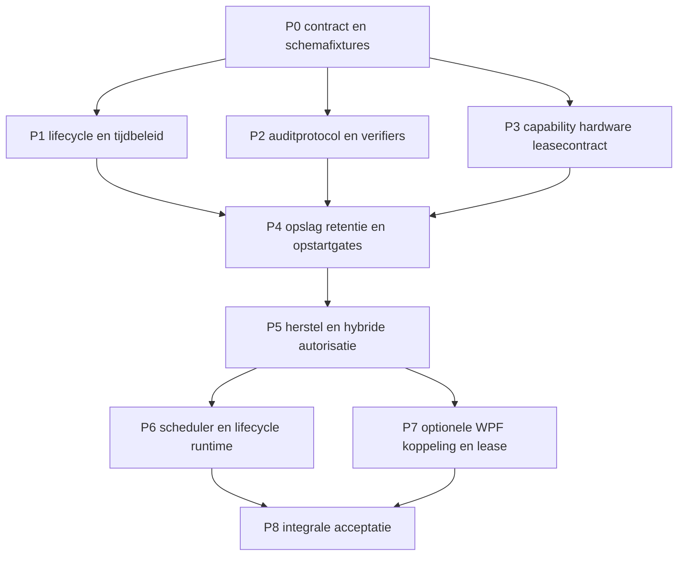

# Gefaseerd implementatieplan — geconsolideerde eventarchitectuur

Datum: 1 november 2026. Status: **plan, geen implementatie of deploymentvrijgave**.

Normatieve basis: [geconsolideerd lifecycleontwerp](phase5-event-lifecycle-design.md), besluiten K01–K23. De [domeinbasis](phase5-domain-foundation.md) is alleen een in-memoryfundament. De [architectuurreview](phase5-architecture-review.md) blijft broninventaris/historische afweging; eerder open functionele hoofdkeuzes zijn nu besloten. Overblijvende technische keuzes T01–T09 staan uitsluitend in het lifecycleontwerp.

## 1. Uitvoerings- en integratieregels

- Iedere fase is een aparte expliciete implementatieopdracht met kleine reviewbare commits. Deze documentopdracht implementeert geen fase en verleent geen toestemming voor actieve migratie, gegevensverwijdering, herstart, deployment of push.
- Gebruik .NET 10, bestaande FIDO2-library, directe SQLite-transacties en bestaande assertionrunners. Geen projectverplaatsing of dependency-upgrade als impliciet onderdeel van dit plan. Nieuwe client-/crypto-/trustdistributie alleen na technische review.
- Eén codebase, eigen data/keys per centrale/offline installatie, optionele HTTPS-koppeling; WPF blijft zelfstandig. Geen netwerkshare-database, verplichte online verifier of automatische bezoekersaccount-/passkeysync.
- Tijden, autorisatie, audit en retentie worden als gezamenlijke veiligheidsbasis afgerond vóór lifecycle-/modulewriters worden geactiveerd. Geen tijdelijk alles-toegestaan-pad, ongetekende kritieke mutatie of oude cleanup naast nieuwe bewaarde accounts.
- Test alleen nieuwe synthetische fixtures in een geïsoleerde bronkopie, met eigen TEMP/TMP, data-/log-/exportmappen en expliciete LUMMA_TEST_WEB_DLL. Geen actieve portal als controle starten. Een testfixture mag zijn eigen data opruimen; bestaande runtime-/archiefpaden blijven beschermd.

## 2. Fasen en acceptatiepoorten

### P0 — Contracten en historische schemafixtures

**Doel en concrete wijzigingen:** zet K01–K23 om naar geversioneerde command-/DTO-/schema-invarianten; leg T09-migratievolgorde en behoudsfixtures vast. Maak de nieuwe version dispatcher geschikt voor historische versies voordat nieuwe tabellen worden toegevoegd. Leg capabilitynamen, foutcategorieën en idempotentie-/auditcontext vast; geen runtimeaanpassing alleen om een test groen te maken.

**Bestanden/projecten:** Web `Services/DemoStore.cs`, `Services/Prizes/PrizeMigration.cs` als historische contractgrens, nieuwe gerichte migrationdispatcher/-contracts; `tests/LummaSimulator.Web.Tests/PrizeMigrationChecks.cs`, `PresenterMigrationChecks.cs`, nieuwe schemafixturehelpers; relevante docs. Historische DDL/fingerprint niet herschrijven naar een nieuwe werkelijkheid.

**Database/security:** nog geen productie-DDL. Vaste volgende versies reserveren; bekende v3–v6-fixtures en onbekende objecten blijven onderscheiden. Referentie-integriteit/authdata niet verzwakken.

**Acceptatie:** verse/legacy/v6-schema's herhaalbaar, onbekende kolom/FK/index/trigger fail-closed, behoud van synthetische accounts/keys/handles/counters/tellingen/Prize-snapshots, injectiefout vóór/na contractgrens rolt alles terug. Alle bestaande regressies groen op eigen bronkopie.

**Risico/rollback:** startup weigert nieuw schema of oude init wijzigt legacydata. Nog niet activeren met echte data; rollback van code zonder schemawijziging mogelijk. Na latere schemawrites uitsluitend compatibele build/forward-fix.

### P1 — Pure lifecycle, tijdvertrouwen en blockbeleid

**Doel en concrete wijzigingen:** uitbreiden DemoEvent-status/revisie/planningcontract, verplichte EndAt, handmatig/automatisch starten, sluiten/catch-up en terminale Archived/duplicatie. Implementeer eerst pure beslisfuncties en tijdabstractie; securityblock als aparte toestand. Sluit T01–T03 voor meetbare drempels, endpointclassificatie en overgangsrecords.

**Bestanden/projecten:** Web Models/DemoEvent.cs, DemoSession.cs waar nodig, nieuwe Lifecycle/TimeTrust-/SecurityBlock-contracten onder Services; bestaande DomainModelChecks en nieuwe Lifecycle/TimeTrustChecks. WPF-productiecode blijft buiten deze fase.

**Database/security:** modellen/fixtures, nog geen productieopslag. Geen invloed van afwezige owner op geldige planning. Blokkade voorkomt verdachte tijd voor mutaties/retentie; beperkt beheerdersherstelpad wordt als contract ontworpen, geen authbypass.

**Acceptatie:** alle toegestane/verboden statustransities, gelijke retries en stale revision; toekomst/verleden/planningedit; gemiste start/einde afzonderlijk en samen; geen fictieve demo-executie bij catch-up; klokterug/vooruit, reboot/suspend, timezone/DST zonder dubbele UTC-overgang. Archived kan niet terug, duplicatie kopieert geen datarechten/run-/claimhistorie. Standalone WPF ongewijzigd.

**Risico/rollback:** wall-clock als betrouwbare expiry behandelen, blokkade laten verdwijnen bij restart. Pure kern kan worden teruggenomen zolang niets aangesloten is; geen oude runtimewriters activeren onder een halve tijdpolicy.

### P2 — Auditprotocol, signing en lokale/centrale verificatie

**Doel en concrete wijzigingen:** T07 kiezen; schema/canonical encoding, keten, segmenten, signatures/checkpoints, keyrotatie en verifierprotocollen. Signing-/verificatie via standaardcryptografie. Centrale verifier ondersteunt idempotente ontvangst van minimale bewijzen; geen volledige audit-/visitorreplicatie.

**Bestanden/projecten:** nieuwe Web audit-/integrityservices en Models; optioneel een afzonderlijk verifierartefact pas na distributiebesluit, geen verplichte projectuitbreiding; `PresenterAuthentication.Audit` later via adapter, geen nu onzichtbaar legacy-rewrite. Web.Tests AuditIntegrityChecks met vaste fictieve testvectoren, foutinjectie en offline fixtures.

**Database/security:** eerst synthetische opslag. Private signingkeys apart beschermd; trustbootstrap/rotatie en publiek verifiermateriaal vastleggen. Auditfout mag kritieke bedrijfsactie niet ongeaudit doorlaten. Geen claim van retroactief getekende legacylogs.

**Acceptatie:** recordwijziging, reorder, duplicate sequence, ontbrekend midden/einde, verkeerde key/signature, checkpointrollback, rotatie en verlopen segment aantoonbaar onderscheiden. Crash na bedrijfscommit vóór checkpoint levert herstelbare signingvoortgang. Geen centrale verbinding vereist; alleen lokaal geverifieerd en centraal bevestigd zijn verschillende statussen. Volledige host/keycompromis blijft expliciete beperking.

**Risico/rollback:** lokale rewrite met meegekopieerde hashketen, onbegrensde checkpoint-/PII-opslag. Protocolversie/trustepoch behouden; niet opnieuw hashen om een incident te verbergen. Vóór runtimewriters kan adapter worden teruggenomen; daarna alleen compatibele verifier/forward-fix, bewijs intact.

### P3 — Capability-, transfer-, noodtoegang-, YubiKey- en leasecontracten

**Doel en concrete wijzigingen:** T04–T06 sluiten: capabilitybundels en scopechecks, hybride Prize-policy, transferacceptatie/noodtransfer, geregistreerde beheerders-YubiKey en recovery, tijdelijke lease/fencing. Systeembeheer nooit als impliciete Claim.Handle/PII-rechtbron. Leases en ownership zijn afzonderlijke aggregaten.

**Bestanden/projecten:** Web Models, `PresenterAuthentication.cs`/`PresenterManagement.cs` gecontroleerde hergebruikpunten; nieuwe EventAuthorization/Ownership/EmergencyAccess-/Lease-services; `PrizeAuthorization.cs` als later aansluitpunt; bestaande Presenter/Discoverable/MultiCredentialChecks en nieuwe scope-/recovery-/leasetests.

**Database/security:** alleen eigen fixtures totdat P4 opslag levert. Behoud bestaande accounts/credentials, geen globale Role-CHECK uitbreiden voor louter eventlabels. Geen herstelachterdeur: ook bij klokblokkade beperkte geldige YubiKey-challenge, specifieke herstelcapability en audit.

**Acceptatie:** capabilitymatrix positief/negatief, missing/expired/revoked grant, disabled account, oude idempotente retry na revoke, admin zonder claim-/PII-recht geweigerd op gekoppelde én legacy Prize-route. Transfer alleen na doelacceptatie of geldige noodprocedure; geen dubbele owner door race. Eén leasewriter, stale fencing afgewezen, revoke/netwerkverlies geen dubbele gekoppelde bediening. Hardwaretrust met primaire/reserve-YubiKey en herstel fysiek geaccepteerd vóór afdwinging; mocks alleen geen merkbewijs.

**Risico/rollback:** admin krijgt via Presenter-claim alsnog datarecht, hardwarecutover sluit beheerders uit. Houd runtimegates dicht tot recoveryacceptatie; geen nieuwe credentials/keys blind relabelen. Na activering rollback mag revoked grants/hardwarebewijs niet versoepelen.

### P4 — Geversioneerde opslag, centrale retentieguards en veilige opstartvolgorde

**Doel en concrete wijzigingen:** M1–M5 uit het ontwerp op synthetische databases realiseren: parents/sessies/runlinks, operations, grants/transfers/noodtoegang, lease, block/time-state, retentieprofielen/voortgang, auditsegmenten/checkpoints. Sluit T08/T09: ankers, defaults, legacy-audit-/backupovergang en exacte DDL. Nieuwe startupvolgorde controleert tijd/integriteit vóór cleanup/lifecycle/verkeer.

**Bestanden/projecten:** Web DemoStore/nieuwe migrationdispatcher, Program-compositie, nieuwe domeinrepositories; DemoService **alle** delete-/handoveringangen; SessionStatusService.GetAsync; PresenterService.CleanupWorker; nieuwe RetentionPolicy/Coordinator en auditopslag; Web.Tests migration/retention/startup-/crashchecks.

**Database/security:** nieuwe vaste markers boven 6; geen wijziging van historische v6-contracten. Nullable moduleparentlinks blijven zonder automatische backfill. Geen fysieke datahandeling op bestaande installaties binnen een codeopdracht. ProfileVersions bevatten Demo 7/Workshop 14/Onderwijs 90, audit 90/statistiek 365/backup 14 dagen; Prize apart. Geen verruiming van tijdelijke bezoekersopslag tot een profielminimum.

**Acceptatie:** defaultseeds eenmaal, latere profielwijziging verlengt oude deadlines niet ongemerkt; bewaartermijnanker juist; alle deletepaden met nonparticipant/participant/cancelled/multievent/laatste binding; 200-cap en behouden accounts apart; klokvooruitsprong veroorzaakt geen massadelete; recovery catch-up correct. FK's en credentialbytes/tellingen blijven; auditsegmentexpiry breekt verificatie niet en legacytriggers worden niet ad-hoc uitgezet. Geen cleanup vóór trusted-time/auditstartupgate; corrupte audit/bloktoestand stopt gevoelige writers, WPF blijft onafhankelijk.

**Risico/rollback:** schema-/cleanupcombinatie kan data vernietigen. Fout vóór commit rollback; na nieuwe writes compatibele behoudende build/forward-fix. Oude v6-binary niet op nieuw schema of behouden accounts draaien. Consistente pre-upgradebackup/restore alleen na aparte toestemming; huidige toestand en oorspronkelijke keyring/DPAPI-context behouden.

### P5 — Beheerdersherstel, overdracht en hybride module-autorisatie aansluiten

**Doel en concrete wijzigingen:** beveiligde pagina's/handlers voor grants, acceptatie/noodtransfer, noodtoegang en blockherstel; gewone versus gevoelige datarechten apart. Gekoppeld Prize-event volgt parentcapabilities, ongekoppeld gewone legacyrechten. Koppelactie toont scopeverandering en vergt rechten op bron én parent; ontkoppeling mag geen verborgen legacyprivilegeverbreding geven. Geen publieke Prize-activering.

**Bestanden/projecten:** Web Program authscope/policies, Presenter-pages/resources/presenter.js, PresenterService.Actor-adapter, PrizeAuthorization/PrizeEventStore/Service, nieuwe gerichte beheerpages/services; HTTP/Node-/scope-/PII-negative checks.

**Database/security:** opslag uit P4; geen extra schema uit gemak. Elke mutatie actor/grant/block/CAS/idempotentie/audit in dezelfde transactie. Critical recoverypad blijft beschikbaar zonder geblokkeerde wall-clock-expiry te vertrouwen; geen algemene authentication-exception.

**Acceptatie:** directe route/ID/POST, cross-event lijst/teller/export, CSRF/Origin, fresh auth/hardware, stale revision; admin zonder datarecht krijgt nooit claim-/PII-payload; noodgrant voor tijdherstel geeft geen claims; doelaccount accepteert zelf; ontbrekende eigenaar stopt planning niet. Legacy Prize normaal beheer ongewijzigd behalve expliciete K15-grens. Link/unlink gelogd en geen authcachelek.

**Risico/rollback:** policyhelft nieuw/oud geeft overbroad toegang. Activeer als één consistente policygate, niet pagina voor pagina. Rollback met nieuwe deny-by-default-backend behouden; geen schema-/grantsverwijdering of herstel van ingetrokken rechten.

### P6 — Runtime lifecycle, scheduler en achterstallige verwerking

**Doel en concrete wijzigingen:** handmatige start, automatische start, verplichte EndAt-sluiting, catch-up na herstart en requestdeadlineguard aansluiten. Gebruik beperkte installatieautoriteit; ownerverlies is geen stopconditie. Securityblock is onafhankelijke gate; oplossing door bevoegde beheerder met audit. Parentmodulelifecycles blijven gescheiden.

**Bestanden/projecten:** Web nieuwe LifecycleService/Worker/TimeTrust-/SecurityBlock-services, Program-startup, Eventbeheerhandlers, repositories/operationrecords; LifecycleHttp/Concurrency/RecoveryChecks en gewone regressies.

**Database/security:** bestaande P4-schema's gebruiken. Eén commit voor event/status/operatie/audit; geen moduleproces of netwerkactie in writer. Geen twee planners die door revisiefout het event dubbel starten. EndAt geldt ook als worker vertraagd is.

**Acceptatie:** handmatig/automatisch start, ongeldige einddatum, due start/einde gelijktijdig, beide gemist offline, restart/race/crash vóór/na commit, revocation eigenaar versus installatieplan, block/unblock-catch-up en auditfout. Geen Active bij verlopen EndAt voor nieuwe uitvoering; geen fake WPF-/Prize-activiteiten tijdens catch-up. Closed alleen allowlistcorrecties; Archived kan niet terug; duplicatie nieuwe ID zonder deelnemers/grants/claims/runs.

**Risico/rollback:** klokincident verkeerde status/retentie, gemiste einddatum bij restarts. Runtimewriters tijdelijk blokkeren via goedgekeurde recoveryprocedure; geen autoriteitsdata wissen of klokchecks uitzetten. Compatibele build, bewaarde dueoperations later veilig opnieuw beoordelen.

### P7 — Optionele WPF-runadapter en exclusieve bediening

**Doel en concrete wijzigingen:** meerdere getypeerde Portal/Simulator-runlinks, veilige pairing en lease/fencing voor gekoppelde bediening; WPF blijft zelfstandig, ook bij serverblock/offline. Geen bestaande JSON omzetten of portal-ID als WPF-ID behandelen. Lokale fallback krijgt expliciete eigen context en wordt niet automatisch remote samengevoegd.

**Bestanden/projecten:** App MainViewModel/SessionMonitorViewModel/SessionMetadataClient, DesktopSettings en NavigatorExportService voor optionele metadata; Web scoped session/runlink-/lease-endpoints; shared uitsluitend kleine geversioneerde contracten indien nodig. Bestaande sidecar/loopbackprotocol behouden.

**Database/security:** P4-relaties/leases gebruiken, geen directe DB-koppeling vanuit WPF. Bronbewijs plus parent/session-grant, geen bearer-UUID of monitor-key als algemeen controlrecht. Leasetoken niet in logs/exports.

**Acceptatie:** meerdere bronnen/runs per sessie, dubbele intentie/race, verwijderde bron, verkeerde event/broninstallatie, stale lease, delayed packet, twee tabs/clients, revoked gebruiker, reconnect, centrale/offline serverblock. Standalone SAFE/LIVE/stop/cleanup/Navigator blijven werken; geen request alleen door monitortab openen. Geen twee writers bij partitie. Als publish/sidecar verandert: alle zeven projecten plus geïsoleerde App-publicatie en Test-LocalHttpPublished.ps1.

**Risico/rollback:** netwerkverlies geeft twee controllers of ongewenste lokale stop. Koppeling uitschakelbaar, lokale bestaande demo intact; tokens/grants intrekken en contexten gescheiden bewaren. Geen automatische historische reparent/import.

### P8 — Integrale offline/centrale, retentie-/backup- en auditacceptatie

**Doel en concrete wijzigingen:** complete keten accepteren met versiegebonden bewijs, onafhankelijke centrale checkpointverificatie én offline werking; gecontroleerde toekomstige installatieprocedure met fysieke sleutels, trusted TLS, DNS/wifi en consistente restore. Geen deployment op basis van dit document alleen.

**Bestanden/projecten:** bestaande Web/Node/Smoke/WPF-runners uitbreiden met P1–P7-scenario's, verificatie-/beheerhandleidingen, schema-/audit-/profilemanifest en herstelprocedure. Geen automatische releaseworkflow toevoegen.

**Database/security:** uitsluitend synthetische fixtureinstallaties of apart uitdrukkelijk toegestane consistent herstelde testsets. Normale autorisatie, timeblock, leases, audit, retentie, backup en moduledeadlines als geheel beoordelen; geen afzonderlijk groen claimen als integratie ontbreekt.

**Acceptatie:** volledige locked restore/build/regressie; koude start zonder internet, gemiste transitions, twijfelachtige rebootklok, YubiKey recovery, eigenaar ontbreekt, noodtransfer, leasepartitie, lokaal auditincident en centraal detecteerbare truncatie/rollback. 7/14/90/365/14-dagenprofielen en afzonderlijk Prize via testklok; geen nieuwe accounts/passkeys door audittransport. Restore vóór verkeer verlopen toegang beoordelen, checkpoints niet stil terugrollen en Prize-uitgifte reconciliëren. Logging bevat geen secrets/PII. Werkelijke fysieke/mobile/TLS/MDR-uitkomsten apart, geen mocks als hardwarebewijs.

**Risico/rollback:** perfecte devtests maskeren operationele tijd-/keycontext. Niet activeren zonder deze acceptatie; ondertekende artefact-/configversies en compatibele herstelbuild beschikbaar. Productie-backup-/herstel-/retentierun pas na concrete toestemming.

## 3. Volgorde en parallelle werkpakketten

P1/P2/P3 kunnen na P0 parallel als pure kernels/testvectoren worden gebouwd, op dezelfde vaste identiteit-/audit-/tijdcontext. Geen concurrerende migraties: P4 is één gecoördineerde schema-eigenaarsgrens. P6 en P7 kunnen na P5 deels parallel, mits lease-/block-/deadlinecontract vaststaat. Centrale verifier kan met testcheckpoints parallel aan lokale services, maar is nooit online prerequisite voor offline demo's. Publieke Prize-deelname/trekking/claimketen blijft een afzonderlijke roadmap en featuregate; dit plan levert niet automatisch Prize 5.2b–5.6.

## 4. Verificatie en bewijs per implementatieslice

Gebruik `dotnet restore LummaSimulator.slnx --locked-mode`, volledige build en `dotnet test tests/LummaSimulator.RegressionTests/LummaSimulator.RegressionTests.csproj` met eigen testportal-DLL. De bestaande orchestrator voert Web.Tests, Node passkeys/localization/presenter, Windows SmokeTests en WPF Verification uit. Behoud migraties, resources, ATT&CK-referenties/licenties, verification-bron en lockfiles. Nieuwe checks toetsen echte invarianten/races, geen kopieën van implementatielogica.

Iedere fase levert: gewijzigde bestanden, schemaversies indien van toepassing, bron-/artifactidentiteit, testconfiguratie zonder geheimen, werkelijke exitcodes/uitkomsten, resterende technische gates, risico's en uitvoerbare rollbackinstructie. Fysieke hardware-, netwerk-/wifi-, productie-TLS-, operationele restore- en MDR-acceptatie worden niet uit softwareauthenticators of mocks afgeleid.

Deze plancommit bevat alleen documentatie. Alleen inhoud/links/Markdown-structuur, staging en geredigeerde secretscontrole zijn nu passend; geen applicatiebuild, tests, active portal, database of cleanup wordt gestart.
