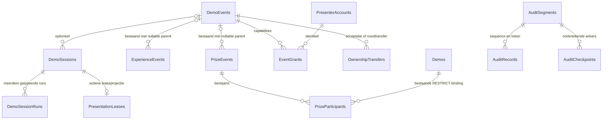
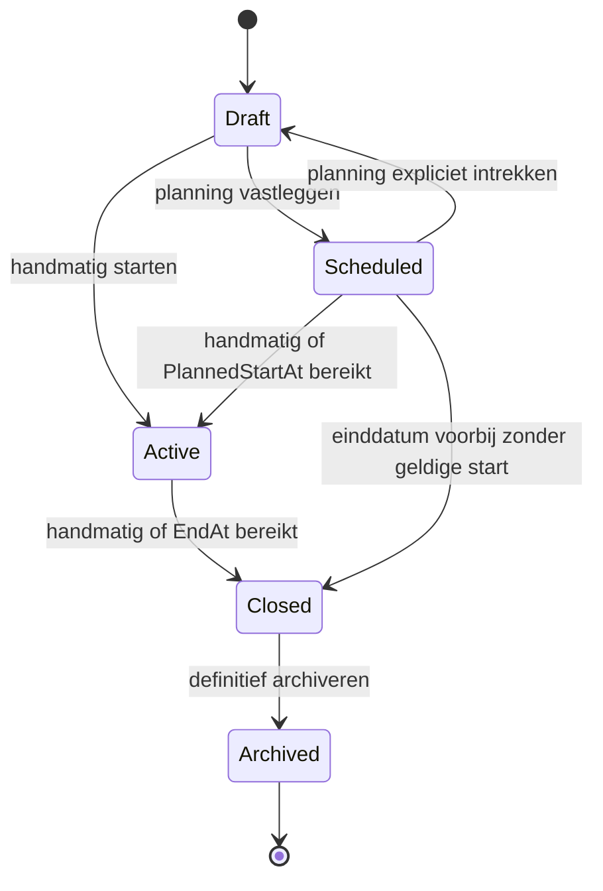

# Geconsolideerd ontwerp — DemoEvents, lifecycle, autorisatie en integriteit

Datum: 1 november 2026. Status: **vastgestelde architectuurbesluiten met technische uitwerking; nog geen database- of runtime-integratie**.

Branch `feature/phase5-domain-foundation`; gecontroleerde schone bronbaseline `fd314b2f925bd74764aae8705f53e55cf08f6d56`. Alleen documentatie wordt aangepast en lokaal gecommit. Geen applicatie gestart, database geopend, migratie uitgevoerd, gegevens verwijderd of configuratie gewijzigd.

## 1. Autoriteit, scope en besluiten

Deze revisie verwerkt de aanvullende expliciete gebruikersbesluiten van 1 november 2026. Bij verschil gaan die besluiten vóór eerdere voorstellen/open vragen in de [architectuurreview](phase5-architecture-review.md), het vorige lifecycleontwerp en de historische Prize-documentatie. [Functionele requirements](../functional-requirements.md), [AGENTS.md](../../AGENTS.md), [domeinbasis](phase5-domain-foundation.md), [hybride requirements](hybrid-deployment-requirements.md) en [Prize-beleid](../phase5-prize-experience-functional.md) blijven gelden waar zij niet expliciet zijn aangescherpt. Implementatiestatus en doelarchitectuur blijven gescheiden.

| Besluit | Definitieve architectuur | Uitwerking |
| --- | --- | --- |
| K01 | DemoEvents is de overkoepelende parent | §3; variant C is gekozen, niet langer A/C open |
| K02 | ExperienceEvents en PrizeEvents blijven bestaan | §3/§9; bestaande IDs, semantiek en historische gegevens behouden |
| K03 | Handmatig en automatisch starten | §4; één transactioneel lifecyclecontract |
| K04 | Automatisch sluiten op ingestelde einddatum verplicht | §4; geen optionele schedulerfeature |
| K05 | Gemiste overgangen na herstart verwerken | §4; idempotente, chronologische catch-up |
| K06 | Verdachte systeemklokwijziging geeft aparte beveiligingsblokkade | §5; geen zesde eventstatus |
| K07 | WPF blijft zelfstandig functioneren tijdens blokkade | §5/§7; geen remote stop of lokale cleanup |
| K08 | Alleen bevoegde beheerders heffen blokkades op | §5/§6; specifieke capability en geregistreerde YubiKey |
| K09 | Meerdere getypeerde DemoRunIds per DemoSession | §3/§7; aparte runreferenties |
| K10 | Exclusieve tijdelijke presentatorlease | §7; fencing, expiry en intrekking |
| K11 | Prize-autorisatie hybride: gekoppeld eventrechten, ongekoppeld bestaand | §6; gecontroleerde koppeling/cutover |
| K12 | Eigendomsoverdracht via acceptatie of gecontroleerde noodoverdracht | §6; geen simpele OwnerId-update |
| K13 | Ontbrekende eigenaar stopt bestaande planning niet | §4; installatieautoriteit, niet de browsersessie |
| K14 | Rollen krijgen eventgebonden capabilities | §6; bestaande beheerdersidentiteiten hergebruiken |
| K15 | Systeembeheer geeft geen automatische PII-/claimtoegang | §6; afzonderlijke datarechten, ook bij legacy Prize |
| K16 | Verhoogde rechten via gecontroleerde noodtoegang | §6; beperkt doel, scope, looptijd en audit |
| K17 | Beheerders gebruiken geregistreerde YubiKey | §6; geen hardwareclaim op basis van label/attestation none |
| K18 | Gestructureerde append-only audit met cryptografische integriteitscontrole | §8; keten en ondertekende checkpoints |
| K19 | Centrale verificatie van auditintegriteit ondersteund | §8; optioneel transport, lokale verificatie blijft mogelijk |
| K20 | Archived definitief; hergebruik via duplicatie | §4; nieuwe identiteit zonder credentials/deelnames |
| K21 | Parent en modules hebben gescheiden lifecycles | §4/§9; geen onzichtbare statuscascade |
| K22 | Closed laat alleen beperkte administratieve correcties toe | §4/§6; geen nieuwe normale uitvoering |
| K23 | Centrale configureerbare retentieprofielen | §8; vastgestelde defaults, Prize apart |

De architectuur gebruikt één codebase voor centrale en offline installaties. Elke installatie beheert eigen database, keyring, tijdvertrouwen en auditidentiteit. Internet is geen runtimevoorwaarde; centrale auditverificatie is geen bezoekersaccount-/passkeysynchronisatie. Er is geen automatische overdracht van bezoekersaccounts of passkeys. WPF blijft onafhankelijk en krijgt geen portal-databaseverbinding.

## 2. Huidige implementatie en relevante verschillen

| Bronanker | Feitelijke toestand op baseline | Nog te implementeren |
| --- | --- | --- |
| `LummaSimulator.Web/Models/DemoEvent.cs`, `DemoSession.cs` | Get-only in-memorymodellen met UUID, UTC CreatedAt; event heeft naam, sessie optionele event-ID | Lifecycle/revisie, opslag, grants, planning en runreferenties |
| `Services/ExperienceStatistics.cs`, `PresenterManagement.cs` | Eén Active ExperienceEvent; VisitorCounts bewaart eerste nummer/context, authenticaties tellen in dan actieve context | Nullable parentkoppeling, expliciete eventselectie zonder historische hertelling |
| `Services/Prizes/PrizeEventService.cs`, `PrizeEventStore.cs`, `PrizeAuthorization.cs` | Gedeeld installatiebreed beheer; Draft/Open/Closed/Purging; CAS/idempotentie; PrizeEnabled=0 | Hybride autorisatie, aparte claim-/PII-capabilities; publieke keten blijft aparte gate |
| `Services/PresenterAuthentication.cs`: Actor/ValidateAsync/SetAccountAsync | DB-sessie-/accountcheck, Administrator/Presenter, verse herauth; admin krijgt ook Presenter-claim; attestation none | Capabilitypolicy, geregistreerde beheerders-YubiKey, noodtoegang en transferacceptatie |
| `PresenterAuthentication.cs`: PresenterAudit-triggers | Normale UPDATE/DELETE afgewezen; geen cryptografische keten | Geversioneerd integriteits-/segmentcontract; geen historische ondertekening veinzen |
| `Services/DemoService.cs`, `SessionStatusService.GetAsync` | Meerdere directe accountdeletes; idle, einde, handover en monitor-GET | Centrale retentiebeslissing vóór integratie; toegang en fysieke delete scheiden |
| `Services/Prizes/PrizeMigration.cs`: Validate/PreflightAsync | Exacte schemaobjecten en histories t/m 6; v6-fingerprint | Geversioneerde dispatcher vóór nieuwe schema's |
| WPF MainViewModel.BeginSession / NavigatorExportService.CreateLayer | Eigen run-ID; portal-/simulator-ID apart; onafhankelijk van Web | Optionele geverifieerde sessiereferentie en lease voor gekoppelde bediening |

Geen van K03–K23 wordt al geleverd door alleen de bestaande modellen of oude tests. De eerdere 566 webcontroles/43 Node-tests zijn historische verificatie van de domeinbasis, geen nieuwe uitvoering of acceptatie van dit ontwerp.

## 3. Datamodel en relaties

De onderstaande objecten zijn logische opslagcontracten, geen uitgevoerde DDL. Gebruik de bestaande Web-assembly en bestaande identiteiten; geen projectverplaatsing of duplicerend bezoekers-/credentialregister. UUID's als canonical TEXT aan opslaggrenzen, UTC-tijdstippen volgens bestaande millisecondenconventie. Exacte schema's en vaste migratiemarkers worden vóór de implementatieslice vastgelegd.

| Object | Kernvelden en relaties | Invarianten |
| --- | --- | --- |
| DemoEvents | Id, Name, CreatedAt, Status, Version, StartMode, PlannedStartAt?, EndAt, ActivatedAt?, ClosedAt?, ArchivedAt?, OwnerAccountId?, RetentionProfileVersion | Vijf statussen; tijdvolgorde; einddatum verplicht voor een geplande/actieve nieuwe uitvoering; NULL-owner is hersteltoestand, geen stopflag |
| DemoSessions | Id, CreatedAt, DemoEventId?, Version, uitvoering-/eindecontext en profielreferentie | Zonder event mogelijk; geen authenticatiesessie; geen verborgen bezoekerretentie door alleen correlatie |
| DemoSessionRuns | Id, DemoSessionId, RunSource, DemoRunId, bron-/installatiecontext, LinkedAt, LinkedBy en revisie | Meerdere runs per sessie; bron expliciet Portal/Simulator voor huidige functies; geen run-ID vervangen; geen stil dupliceren/verplaatsen |
| ExperienceEvents / PrizeEvents | Bestaande objecten plus nullable DemoEventId en lookupindex | Eén parent per module-event; parent kan meerdere module-events hebben; bestaande PK/FK's/statuswaarden behouden |
| EventGrants | Id, DemoEventId, PresenterAccountId, capabilities, ValidFrom, ExpiresAt?, RevokedAt?, IssuerId, Version | Actuele scopes, geen rechten uit creator of UUID; geen automatische globale beheerdersrol |
| OwnershipTransfers | EventId, FromOwner?, ToAccountId, intentie, status, aangevraagd/geaccepteerd/ingetrokken, revisie | Acceptatie door doelaccount; concurrerende transfers/CAS; noodvariant verwijst naar noodgrant |
| EmergencyAccessGrants | actor, specifieke capabilities/targets, reden, autorisatiebewijs, beperkte geldigheid, intrekking, reviewcontext | Geen onbeperkte superuser-/PII-bypass; claim-/PII-toegang alleen indien afzonderlijk expliciet toegekend |
| PresentationLeases | SessionId, HolderId/bedieningscontext, tokenhash/referentie, fencingcounter, duur/expiry, revocation, Version | Eén geldige writer per sessie; oude fencingwaarde nooit weer geldig na overname |
| LifecycleOperations | EventId, planningrevision, transitionkind, operation-ID, payloaddigest, due/occurred/recorded timestamps | Uniek per overgang/intentie; audit en eventwijziging atomair; geen browsercookie als taskautoriteit |
| SecurityBlocks / TimeTrustState | installatie/scope, reden, detectie-evidence, UTC-/monotone referentie, boot-ID, revision, resolved-by/proof | Los van Status; aanhoudend na restart; geen automatische opheffing door tijd opnieuw gelijk te zetten |
| RetentionProfiles / RetentionWork | profielversie, dataklasse, termijn, ankerregel; object/deadline/voortgang | Geen stilzwijgende retroactieve verlenging; herstartbare verwijdering, Prize-binding apart |
| AuditSegments / AuditRecords / AuditCheckpoints | installatie/segment, sequence, vorige digest, canonical record, hash, signature/key-ID, seal-/expirycontext | Append-only binnen actief segment; signed segmentgrenzen; verificatie los van beheerdersdatarechten |

Een getypeerde runreferentie is geen bearerrecht. Gebruik voor rununiqueness minimaal bron+installatiecontext+DemoRunId; dezelfde tekst bij verschillende bronnen mag geen samenvoeging veroorzaken. Definitieve regel of één bronrun ooit onder meer dan één sessie mag vallen wordt bij het koppelcontract als technisch invariant vastgelegd (T04); niet alvast een N:M-hergebruikfunctie toevoegen. Nieuwe WPF-herstart krijgt volgens bestaand gedrag een nieuwe run-ID; meerdere daarvan passen nu in dezelfde sessie. De gebruikerskeuze tussen bestaande sessie hervatten en nieuwe sessie maken blijft zichtbaar.

Run-/event-/sessiegegevens blijven onderscheiden van Demos.Id, VisitorNumber, PresenterAuthSessions en PrizeParticipantNumber. Geen credentials, tokens, claiminhoud of uitvoer van echte gebruikers in nieuwe correlatietabellen.

## 4. Lifecycle en verwerking van gemiste overgangen

### 4.1 State-machine

De lijn Scheduled → Closed voorkomt een vals Active-venster voor een nooit gestarte handmatige planning. Bij automatische planning met reeds gemiste start én einde wordt de werkelijke overgangsreeks in volgorde vastgelegd, zonder modules/processen uit te voeren alsof een demo heeft plaatsgevonden. DueAt, EffectiveAt en RecordedAt blijven onderscheiden. De exacte technische eventnamen en behandeling van een Scheduled handmatig-startprofiel worden in T02 vastgelegd; de verplichte uitkomst is geen verlopen event actief laten worden en geen fictieve demo-uitvoering claimen.

| Status | Toegestaan conceptueel gedrag | Grens |
| --- | --- | --- |
| Draft | Configureren, eigenaar/grants beheren, plannen of direct starten | Geen nieuwe publieke module-inschrijving door alleen parentcreatie |
| Scheduled | Planning/capabilities beheren, expliciet starten; automatische start als StartMode=Automatic | EndAt geldig, geen voortijdige automatische activatie; planningrevisies/CAS |
| Active | Nieuwe toegestane sessies en bediening volgens capabilities; EndAt automatisch bewaken | Parent Active opent geen PrizeEvent of WPF-proces |
| Closed | Lezen en beperkte geauditeerde administratieve correcties, overdracht/herstelbeheer, dupliceren of archiveren | Geen heropening, nieuwe normale sessies, nieuwe runkoppelingen of gewijzigde historische uitvoering; precieze correctievelden T03 |
| Archived | Alleen bevoegde historische lezing/export binnen retentie; duplicatie naar nieuw Draft | Definitief, geen terugovergang of mutatie van bronhistorie; gegevens mogen wel volgens retentie verlopen |

Closed → Active wordt niet aangeboden in de geconsolideerde lifecycle: operationeel hergebruik gebeurt via duplicatie. Bestaande Prize-Reopen blijft een afzonderlijke moduleactie binnen zijn eigen deadlines. Archiveren is expliciet, geen nieuwe automatische archiveringsdeadline. Duplicatie maakt een nieuwe DemoEvent-ID en nieuwe planning; kopieert alleen geselecteerde configuratie/profielreferenties, nooit deelnemers, passkeys, claims, audit, actieve grants, leases of runhistorie. Het bronevent wordt niet gewijzigd.

De terminale status verhindert geen noodzakelijke intrekking van afzonderlijke toegangsgrants, normale retentie of het toevoegen van audit-/verificatiebewijs over het archief. Die operaties wijzigen niet de historische eventuitvoering en geven het event geen nieuwe operationele lifecycle.

EndAt is een verplichte valide grens voor nieuwe Scheduled/Active events; handmatig starten vervalt niet de automatische sluitplicht. Verzetten mag een reeds geregistreerde sluiting niet ongedaan maken. Historische module-events krijgen niet automatisch een einddatum of nieuwe lifecycle. Niet-gerelateerde standalone WPF-runs blijven mogelijk.

### 4.2 Eén overgangscontract

Handmatige commando's gebruiken bestaande DB-Actor plus eventcapability, precieze route-/body-scope, Origin/CSRF, verwachte Version en idempotentie. Binnen één `BEGIN IMMEDIATE`: tijd-/blokkadecontrole, actuele autorisatie, eerdere intentie na autorisatie lezen, status/CAS, lifecycleoperatie en auditappend, commit. Geen netwerk, animatie of processtart binnen een writertransactie.

Automatische taken gebruiken een beperkte installatieprincipal. Een geautoriseerd opgeslagen plan blijft van de installatie, niet van een eigenaarssessie. Een verwijderde/uitgeschakelde eigenaar of verlopen individuele grant stopt bestaande planning dus niet. Een bevoegde actuele actor kan planning expliciet wijzigen/intrekken zolang de lifecycle dit toelaat; een beveiligingsblokkade schort uitvoering wel op. Taken krijgen geen PII-/claim-, accountbeheer- of algemene DB-cleanuprechten.

Start-/close-idempotentie is event+planningrevision+overgang, niet één globale UUID-cache. Iedere route moet vóór nieuwe operationele writes vervallen parentdeadlines verwerken of de write afwijzen; een trage worker mag EndAt niet verlengen. Auditfout voor een kritieke mutatie laat de transactie mislukken; geen ongeauditeerde noodpadactie.

### 4.3 Herstart en achterstand

Opstartvolgorde na eventuele geautoriseerde migratie: schema valideren → tijdvertrouwen/blokkades laden → auditketen lokaal verifiëren → alleen bij betrouwbare toestand achterstallige lifecycleovergangen verwerken → deadline-/retentiecontrole → normale writers toelaten. De actieve portal wordt nu niet gestart; dit is de toekomstige runtimevolgorde.

Due transitions worden per event chronologisch en revision-safe verwerkt, ook bij meerdere workers. Bij gemiste automatische start/einde blijven oorspronkelijke due times zichtbaar en worden echte verwerkingstijden toegevoegd. Geen replay van WPF-processen, trekkingen of browseracties. Een al Closed/Archived event krijgt geen tweede start. Tijdens klok-/integriteitsblokkade wordt de achterstand bewaard, niet gewist of uitgevoerd; na bevoegde vrijgave opnieuw op de actuele vertrouwde tijd beoordelen.

## 5. Tijdvertrouwen en afzonderlijke beveiligingsblokkade

Klokblokkade is orthogonaal: bijvoorbeeld LifecycleStatus=Active én SecurityBlock=Open. Niet omzetten naar Closed/Purging en geen zesde lifecyclewaarde toevoegen. Bewaar detectiereden, laatste vertrouwde referentie, bootcontext en revision; detectie én herstel zijn auditeerbaar, ook wanneer wall-clocktijd onbetrouwbaar is.

Gebruik een tijdabstractie met UTC en monotone verstreken tijd binnen dezelfde boot/procescontext. Vergelijk verwachte UTC-progressie met wall-clock, detecteer terug-/vooruitsprongen en ongeldige herstartreferenties. Monotone tijd is geen betrouwbare kalender over een reboot; zonder extern anker kan offline software niet iedere gemanipuleerde klok bewijzen. Grote verdachte verschillen leiden tot blokkade, niet tot stil vertrouwen of verplichte internet-timecheck. Drempels, suspend/resume, slewing en reboot-validatie staan in T01. [Stopwatch voor verstreken tijd](https://learn.microsoft.com/en-us/dotnet/api/system.diagnostics.stopwatch?view=net-10.0).

Tijdens blokkade worden tijdafhankelijke lifecyclewrites, lease-uitgifte/overname, grant-/noodtoegangsuitgifte, deadlinegevoelige claim-/PII-mutaties en destructieve retentie gepauzeerd of geweigerd; geen massadelete door een sprong vooruit en geen verlengde toegang door een sprong terug. Reeds geblokkeerde datarechten worden niet via een cache toegestaan. Read-only publieke statussignalen blijven geschoond. De precieze endpoint-/actieclassificatie wordt bij T01 als testbare matrix vastgezet, inclusief andere securityblocks.

Beheerderherstel is een afzonderlijk strikt beperkt pad dat ook bij blokkade werkt: bestaande actieve beheerdersidentiteit, geregistreerde YubiKey, verse challenge met monotone korte geldigheid binnen de herstelpoging, capability SecurityBlock.Resolve, geredigeerde inspectie, reden en expliciete bevestiging. Een gewone eventeigenaar of sysadminlabel alleen volstaat niet. Geen algemeen uitschakelen van auth/CSRF/TLS, geen OS-klokwijziging vanuit een Save-knop en geen automatisch vertrouwen in de huidige klok. Na correctie/validatie een nieuw betrouwbaar anker vastleggen, audit append, blokkade-CAS sluiten en catch-up hervatten. Bestaande grants niet resurrecten en oude sessies niet langer geldig maken. Verloren beheersleutels volgen gecontroleerde recovery/noodprocedure, geen wachtwoordfallback.

WPF SAFE/LIVE, eigen logs, cancel/stop en lokale sidecar blijven zelfstandig bruikbaar; deze blokkade stuurt geen remote kill of filecleanup. Gekoppelde serverbesturing/datawrites blijven geweigerd. Een lokale demo mag niet doorgaan onder het mom van een nog geldige remote lease: ontkoppelde lokale uitvoering blijft apart herkenbaar en wordt niet achteraf automatisch als geautoriseerde remote run geüpload.

## 6. Capabilities, hybride Prize-autorisatie en herstel

### 6.1 Principals en beleid

Hergebruik PresenterAccounts, PresenterKeys en PresenterService.Actor; geen nieuw wachtwoord-/authsysteem. Bestaande globale rolbenamingen blijven; eventgebonden rechten zijn expliciete capabilities. EventOwner, EventManager en DelegatedPresenter zijn scope-/pakketlabels, geen automatisch universele rechten. Voor iedere read/mutatie checkt de server identiteit, scope, capability, lifecycle, grant/recoverygeldigheid, securityblocks en waar relevant lease. Filters vóór paginering/tellers/export. Oude succesvolle operatiecache geeft geen inhoud terug na revoke.

Technische capabilityfamilies: Event.Read/Create/Configure/Schedule/Start/Close/Correct/Archive/Duplicate; Event.Grants.Manage; Event.Ownership.Transfer/Accept; Session.Manage/LinkRun/Control; Prize.Manage/Claim.Handle; PersonalData.Read/Export; SecurityBlock.Resolve; EmergencyAccess.Authorize/Use; Retention.Manage; Audit.Verify/Read. Dit zijn controlepunten voor de bestaande besluiten; exacte bundels/issuer-/goedkeuringsregels in T05, geen onbesliste auto-grants.

**Matrixlegenda:** G = expliciete geldige eventcapability; I = expliciete installatiecapability; D = afzonderlijke data-/claimcapability; Z = eigen visitorbinding; L = bestaande ongekoppelde Prize-policy; V = geldige lease met fencing; H = geregistreerde beheerders-YubiKey plus vereiste verse auth; N = geen recht uit deze context. Een cel met capability is nooit automatisch aan die rol toegekend. Noodtoegang kent alleen de daarin genoemde scope/acties toe.

| Actie | Systeembeheer zonder event-/datarecht | Eventeigenaar/medebeheer | Tijdelijke delegatie | Bezoeker | Systeemtaak / centrale verifier |
| --- | --- | --- | --- | --- | --- |
| Eventcatalogus zonder PII lezen | I | G voor eigen/toegewezen | G binnen geldigheid | N | Alleen noodzakelijke taskmetadata |
| Event maken/configureren/plannen | I expliciet | G | G expliciet | N | Geen algemene beheeractie |
| Handmatig starten/sluiten | I expliciet | G | G expliciet | N | Alleen opgeslagen lifecycleplan |
| Automatisch starten/sluiten/catch-up | Geen privilege uit rol nodig | Geen eigenaar aanwezig vereist | Grantverval stopt plan niet | N | Beperkte installatieprincipal, tijd/blokkadecheck |
| Correctie Closed | I expliciet, allowlist | G + allowlist | G + allowlist | N | N |
| Archived wijzigen/heropenen | N | N | N | N | N |
| Archiveren/dupliceren | I expliciet | G | G expliciet | N | Geen automatische archivering |
| Grants beheren | I + H expliciet | G, geen zelfescalatie | Alleen expliciet issuerrecht | N | N |
| Eigendom overdragen | Alleen gecontroleerde noodoverdracht met I + H | Transferintentie, doel accepteert | Geen automatisch transferrecht | N | N |
| Beveiligingsblokkade opheffen | I SecurityBlock.Resolve + H | Alleen indien tevens die beheerbevoegdheid + H | Geen eventgrant alleen | N | Geen automatische opheffing |
| Noodtoegang activeren | Expliciete procedure + H | Alleen specifieke toegekende bevoegdheid + H | Geen generiek recht | N | Geen algemene noodprincipal |
| Session-/runlinks beheren | I expliciet | G | G | Geen eventbeheer via run-ID | Geen automatische import |
| Gekoppelde sessie bedienen | G + V indien apart verleend | G + V | G + V | Eigen bezoekersflow is apart | Geen autonome processpawn |
| Gekoppeld PrizeEvent beheren | G expliciet, niet sysadminclaim | G Prize.Manage | G Prize.Manage | Eigen toekomstige deelnameflow | Alleen specifieke moduleworker |
| Ongekoppeld PrizeEvent gewoon beheer | L; geen impliciete datarechten | L indien bestaande Presenterpolicy | L indien bestaande Presenterpolicy | Eigen toekomstige deelnameflow | N |
| Claims behandelen of PII lezen/exporteren, gekoppeld én ongekoppeld | **Geen automatisch recht**; D expliciet | D + toepasselijke event/legacycontrole | D + toepasselijke scope | Alleen eigen toegestane toekomstige flow | Geen payload voor lifecycle/auditverifier |
| Retentieprofielen beheren | I + H | Alleen expliciete beleidsscope, geen datavrijstelling | Geen standaardrecht | N | Alleen vastgestelde policy uitvoeren |
| Auditmetadata lezen/verifiëren | I, minimale geautoriseerde weergave | G waar toegestaan | G waar toegestaan | N | Checkpoints/public keys; geen impliciete auditpayload/PII |
| Globale accounts/deployment beheren | Bestaande I/adminpolicy + H, onderhoudsgrenzen | N uit eventrol | N uit eventrol | N | N |
| Eigen bezoekerpasskey/demo gebruiken/eindigen | Alleen Z, niet systeemrol | Alleen Z | Alleen Z | Z | N |

### 6.2 Hybride Prize-policy en bestaande claims

PrizeEvents.DemoEventId niet NULL: eventcapabilities plus bestaande bedrijfs-/sessiechecks. NULL: bestaande beheerders-/presentatorpolicy voor gewone Prize-beheeracties. **K15 is een expliciete aanvullende begrenzing op beide paden:** de huidige admincookie bevat ook Presenter-rol, maar dat mag geen automatische Claim.Handle/PersonalData.Read/Export opleveren. Geen stille privilege-escalatie via legacybranch. Het oude F09/F08-gelijke-toegangcontract is op dit punt door K11/K15 aangescherpt; publieke claimflows zijn nog niet geleverd en moeten deze nieuwe policy vanaf hun eerste implementatie gebruiken.

Koppelen is een bevoegde migratie-/beheeractie met rechten op bron én parent, preview van toegangsgevolgen, CAS, audit en ongewijzigde module-identiteit. Ontkoppelen zou toegang verbreden naar legacybeheer en is daarom geen gewone nullable-field-update; technische procedure in T05. Geen automatische legacykoppeling op naam/datum en geen tijdelijke alles-toegestaan-bypass. ExperienceEvents behoudt bestaande module-specifieke rename-/telregels, begrensd door de gekozen gekoppelde toegang; geen historische herberekening.

### 6.3 Eigendom en gecontroleerde noodtoegang

Normale overdracht: huidige bevoegde eigenaar dient expliciete intentie in voor bestaand doelaccount → doel accepteert met actuele authenticatie → transactionele controle van intentie, owner/revisie en doelstatus → eigenaar wijzigen en audit. Voor acceptatie blijft de huidige eigenaar eigenaar. Geen transfer door alleen een link te openen; verlopen/ingetrokken/stale intentie wijzigt niets.

Ontbrekende/uitgeschakelde eigenaar wordt zichtbaar als beheerprobleem, niet als planningstop. Gecontroleerde noodoverdracht gebruikt een specifiek noodgrant, geregistreerde beheerders-YubiKey, reden, scope en bewijs van de bevoegde procedure. Geen fictieve acceptatie namens de ontbrekende gebruiker. Approval/quorum en looptijden worden technisch vastgelegd in T05; normale transferacceptatie en noodtransfer mogen niet dezelfde ongecontroleerde OwnerId-setter worden.

Verhoogde rechten zijn tijdelijk, doel-/actiegebonden en auditeerbaar, met intrekking en review. Systeembeheertoegang geeft niet automatisch PII of Prize-claims; een noodgrant voor klokherstel of transfer evenmin. Alleen een expliciet bevoegde data-noodprocedure kan zulke rechten noemen. Onafhankelijke logging van goedkeuring, gebruik, afloop en geweigerde pogingen is verplicht; geen verborgen permanente masteraccount.

### 6.4 Geregistreerde YubiKey

De beheerderscredential moet aan het betreffende account geregistreerd zijn en als toegestane YubiKey zijn gecontroleerd. Bestaande attestation-none, user verification, backupflags, browserkeuze of naamlabel bewijzen merk/hardware niet. Kies vóór afdwinging een getoetst attestation/provisioning-/trustbeleid met de bestaande FIDO2-library, offline trustdata, reservekey en gecontroleerde recovery (T06). Geen eigen cryptografische verificatie, geen bestaande key achteraf blind als bewezen labelen, geen bezoekersattestationbeleid cosmetisch wijzigen. [WebAuthn-attestation](https://www.w3.org/TR/webauthn-3/#sctn-attestation).

## 7. Meerdere runreferenties en exclusieve lease

Een DemoSession bevat nul of meer expliciet getypeerde runreferenties. Portalrun uit Demos en WPF-run uit lokale logs zijn verschillende bronnen. Actor valideert sessie/eventrecht én bronbevoegdheid; monitor-GET/grant alleen is geen LinkRun-recht. Opvragen van willekeurige UUID's mag geen event-/accountenumeratie veroorzaken. Idempotente koppelactie bewaart bronbewijs, revision en audit zonder cookies of credentials.

Geen automatische visitorretentie door alleen een runlink. Een later verdwenen bron krijgt een ontbrekende/gepurgete bronstatus of geminimaliseerde verwijzing volgens retentie; nooit een account, credential of claim reconstrueren. Reparenten verandert toegangs-/bewijscontext en vraagt expliciet geautoriseerde correctie, geen vrije update. In Closed alleen de goedgekeurde administratieve correcties; geen nieuwe uitvoeringshistorie fabriceren.

Exclusieve lease: atomair verkrijgen/vernieuwen/overdragen per DemoSession, beperkte duur, servercontrole, tokenbinding en stijgende fencingcounter. Elk commando draagt lease-/session-/operationcontext; geldige capaciteit plus huidige fencing vereist. Verlopen of ingetrokken houders kunnen niet via vertraagde requests blijven schrijven. Overname vereist expliciet recht, audit en ongeldig maken oude lease; lease is geen eventeigendomsoverdracht. Timing/heartbeat/partitionbeleid in T04, inclusief monotone expiry en blokkade. Meerdere tabs of WPF/portal worden geen twee writers.

Standalone WPF vereist geen serverlease. Voor dezelfde gekoppelde sessie mag offline fallback echter niet tegelijk met een nieuwe remotehouder schrijven. Bij verlies van autoriteit stopt gekoppelde commandotoegang; zelfstandige lokale demonstratie blijft mogelijk in een expliciet aparte runcontext. Geen achteraf stille merge van die runs of dubbele bediening onder één lease.

## 8. Centrale retentie en auditintegriteit

### 8.1 Configureerbare profielen

| Profiel/dataklasse | Vastgestelde standaard | Toepassing en grens |
| --- | --- | --- |
| Demo | 7 dagen | Retentie van daartoe bestemde demo-/sessie-/runmetadata, geen verplichte minimumopslag van cookies/passkeys |
| Workshop | 14 dagen | Geselecteerd profiel met vaste versie/anker, niet installatiebreed alle bezoekers bewaren |
| Onderwijs | 90 dagen | Zelfde gescheiden account-/sessie-/bewijsclassificatie |
| Auditlogs | 90 dagen | Geversioneerde segmentretentie, geen onveranderlijk permanent persoonsarchief |
| Geanonimiseerde statistieken | 365 dagen | Alleen werkelijk ontkoppelde aggregaten; pseudonieme UUID-data zijn niet automatisch anoniem |
| Backups | 14 dagen | Beschermde consistente herstelsets, geen zelfstandig langer eventarchief |
| Prize | Bestaand afzonderlijk beleid | Expliciete opt-in, 1–90 dagen/standaard Cybertruck 30 dagen na sluiten, oorspronkelijke PurgeAt-bovengrens en claimdeadlines behouden |

ProfileVersion wordt bij aanmaak/beleidskeuze vastgelegd; gewijzigde defaults veranderen bestaande deadlines niet zonder expliciete bevoegde/auditeerbare beleidswijziging. T08 legt de precieze ankers vast (voorstel: einde sessie, ClosedAt voor eventgebonden data, record-/segmenttijd voor audit, creatie backup). Termijnen zijn nu **besloten**, niet opnieuw een functioneel open punt. Technisch moet worden vastgelegd hoe één profiel op meerdere dataklassen en onbekende eindtijd wordt berekend.

De oudere standaard verwijderen bij sessie-einde en huidige 1–29 minuten idle voor tijdelijke accounts blijven de privacybasis voor niet-deelnemers. Nieuwe 7/14/90 dagen maken daarvan geen minimumaccountretentie en schrijven bestaande accounts niet om. Alleen noodzakelijke, expliciet geclassificeerde metadata of Prize-opt-in kan langer blijven. Audit 90 dagen en anonieme statistiek 365 dagen zijn afzonderlijke doelklassen. Een event Archived houdt deadlines niet tegen. Configureerbare profielen zijn geen toestemming voor onbeperkte bewaring.

De centrale service scheidt Revoke, Expire, RetainUntil en DeleteEligible. Alle paden in DemoService.OwnedCoreAsync/CleanupCoreAsync/EndOwnAsync/EndAsPresenterAsync/CreateAsync(previousToken) én SessionStatusService.GetAsync gebruiken dezelfde transactionele guard. PrizeParticipants, inclusief cancelled/niet-winnend, en overige noodzakelijke bindings worden beoordeeld; RESTRICT is geen foutafhandelingsvervanging. Multi-event bewaart slechts zolang noodzakelijk; oude cookies worden nooit teruggegeven. Accountcap moet actieve demo's en behouden accounts afzonderlijk begrenzen.

Requestdeadline geldt ook zonder worker. Bij betrouwbare tijd werkt cleanup herstartbaar in FK-veilige batches, met fileoperaties buiten de DB-writertransactie en geregistreerde voortgang. Klokblokkade voorkomt destructieve delete op verdachte tijd. Na vrijgave eerst deadlines opnieuw berekenen zonder ze te verlengen. WPF-logs/export en externe downloads vragen eigen beheeradapter; geen externe archieven recursief opschonen. Backups worden volgens beleid geroteerd na afzonderlijke uitvoeringstoestemming, nooit nu.

### 8.2 Gestructureerde append-only audit

Auditrecord bevat schemaversie, installatie-/segment-ID, oplopende sequence, operation/correlation, actie/resultaat, getypeerde minimale target-/actorreferentie, UTC-kwaliteit, monotone/bootcontext waar relevant, vorige digest en huidige digest. Geen ruwe persoonsnamen, requestbodies, cookies, keys of claiminhoud. Ook hashes/identifiers kunnen herleidbaar zijn: toegang/retentie blijven gelden.

Technische uitwerking: deterministische canonical encoding → hashketen → periodiek en bij segmentafsluiting een ondertekend checkpoint met installatie, sequencebereik, laatste digest, vorige checkpointreferentie, key-ID en schemaversie. Gebruik bestaande standaardcryptografie/library-API's, geen eigen signingprimitive. Exact algoritme, canonicalisatie, checkpoints en rotatie in T07. [Cryptografische diensten in .NET](https://learn.microsoft.com/en-us/dotnet/standard/security/cryptographic-services).

Een hashketen alleen beschermt niet tegen een lokale beheerder die alles herschrijft. Handtekeningen en onafhankelijk bewaarde checkpointankers maken wijziging, truncatie, ontbrekende segmenten en rollback beter detecteerbaar. Volledige host-/signingsleutelcompromis kan nog steeds geldige valse nieuwe records toelaten; geen WORM-/absolute forensische waarheidclaim. Signingkeys zijn gescheiden van WebAuthn-private keys en data-encryptiesleutels; publieke verifierkeys zijn distributiegegevens, private keys blijven beschermd buiten Git. Een ingelogde YubiKey wordt niet stilzwijgend automatische logsigner voor een offline achtergrondproces.

Kritieke grant-/transfer-/lifecycle-/claim-/herstelmutatie en auditappend zijn transactioneel gekoppeld. Checkpoints na commit via duurzame seal-/signvoortgang; crash in dat venster mag geen records verliezen of dubbel nummeren. Een checkpoint alleen maakt niet-gecontroleerde eerdere legacylogs niet met terugwerkende kracht betrouwbaar. Nieuwe trustepoch benoemt legacybron en migratiegrens eerlijk.

### 8.3 Retentie van append-only audit

Append-only geldt binnen een actief/verzegeld segment; individuele auditrecords worden niet bijgewerkt of willekeurig verwijderd. Na 90 dagen kunnen volledig verlopen verzegelde segmenten via een specifieke retention-capability en geverifieerd sealbeleid worden verwijderd. Dat is een geversioneerde lifecycleactie, geen gewone DELETE-exceptie voor admin. Behoud een minimaal ondertekend expiry-/continuïteitsbewijs en checkpointgrens volgens getoetste dataminimalisatie, zonder de weggegooide payload te archiveren. T07/T08 bepalen bewijsretentie zodat geen nieuwe onbeperkte indirecte persoonsgegevensopslag ontstaat.

De bestaande PresenterAuditNoDelete-trigger en legacytabel blijven historisch intact totdat een expliciete geversioneerde migratie het opvolgende opslag-/rotatiecontract levert. Geen trigger tijdelijk uitzetten om 90 dagen te halen. Geen claim dat bestaande audit nu al 90 dagen purge of cryptografische integriteit ondersteunt. Legacy overgangs-/expirybeleid vereist aparte toegestane datastap in P4/P5, met behoud van bestaande bewijssets tijdens deze opdracht.

### 8.4 Centrale verificatie zonder cloudafhankelijkheid

Lokale verifier controleert keten, signatures, sequence en checkpointcontinuïteit. Centrale verifier kan dezelfde minimale checkpoints, publieke sleutel-/rotatiebewijzen en expliciete continuity-/expirybewijzen ontvangen of via gecontroleerde offlineoverdracht importeren. Geen automatische verzending van volledige auditpayloads, bezoekersaccounts, passkeys of claimgegevens. Authenticatie/TLS, integriteitsbewijs en geïmporteerde bronidentiteit worden apart gecontroleerd.

Offline checkpoints blijven lokaal duurzaam; later ontvangst is idempotent, duplicaten/gaten/out-of-order zijn zichtbaar. Status onderscheidt lokaal geverifieerd, centraal bevestigd, nog niet aangeleverd en verificatiefout. Niet-centraal-bevestigd is bij offline gebruik geen storing die WPF of normale werking verplicht stillegt. Een lokaal gedetecteerde integriteitsfout krijgt een afzonderlijke beveiligingsblokkade met beperkte herstelprocedure, nooit stil herketenen. Centrale bevestiging verankert wat werkelijk is ontvangen; niet automatisch de correctheid van de onderliggende demo of een MDR-detectie.

## 9. Modules, compatibiliteit en migratievolgorde

Parent heeft Draft/Scheduled/Active/Closed/Archived; ExperienceEvents blijft Active/Closed/Imported; PrizeEvents blijft Draft/Open/Closed/Purging. Parentclose stopt nieuwe parentgebonden operationele starts, maar sluit module-events niet automatisch, vernietigt geen deelnames en trekt geen bezoekerspasskeys in. Bestaande Prize-claims kunnen volgens moduledeadlines worden afgehandeld met expliciete claimrechten, ook als de parent Closed is. Dit is geen administratieve heropening van de parent. Module-specifieke reopen/stockregels blijven intact.

Bij Archived blijven noodzakelijke moduleclaim-/retentieprocessen volgens hun eigen bewaarbeleid werken; parent blijft definitief. Nieuwe moduleoperaties die feitelijk een nieuwe demonstratie vormen zijn niet toegestaan onder een definitieve parent; gebruik duplicatie. De precieze routeclassificatie van afronden versus nieuwe uitvoering staat in T03. Geen naamwijziging van parent die historische module-identiteit omvormt.

| Volgorde | Migratiedoel | Voorwaarde/behoud |
| --- | --- | --- |
| M0 | Geversioneerde preflightrouter vóór de huidige exacte PrizeMigration.Validate | Bekende schema-/markerhistories 3–6 en v6-fingerprint onveranderd als historische contracten; onbekend schema weigeren |
| M1 | Tijdvertrouwen, block-/audittrustepoch en versiecontract | Geen startup-cleanup vóór veilige tijd-/integriteitscontrole; legacybewijs niet herschrijven |
| M2 | DemoEvents/DemoSessions en lifecycleoperations | Parent vóór children, vaste markers boven 6, constraints/CAS/idempotentie, geen automatische legacybackfill |
| M3 | Eventgrants, ownertransfer/noodtoegang, runreferenties en leases | Identiteiten en bestaande auth behouden; geregistreerde YubiKey-cutover pas na recoveryacceptatie |
| M4 | Nullable parentlinks op ExperienceEvents/PrizeEvents en hybride policy | Reviewed mapping; oude module-ID's, samengestelde FK's en OneActiveExperienceEvent behouden |
| M5 | Profielen/retentievoortgang en geversioneerde auditsegment-/checkpointopslag | Alle delete-ingangen guarded vóór nieuwe deelnemers-/correlatie-integratie; legacy auditrotatie expliciet |

Een nieuwe schemawijziging is geen toestemming om een bestaande installatie te migreren. Per migratieslice: bron-/schema-preflight, `BEGIN IMMEDIATE`, DDL/data/manifest en marker atomair, integrity/FK-check, foutinjectie vóór/na kritieke stap en synthetische behoudsvergelijking. Geen foreign_keys=OFF, profielseedoverschrijving of historie verwijderen om checks te laten slagen. Schemanummers pas bij implementatie reserveren; niet MAX+1 afleiden.

Legacy ExperienceEvents/PrizeEvents blijven ongekoppeld zolang geen geautoriseerde mapping bestaat. Geen OwnerAccountId uit auditcreator afleiden. Domein-ID's/credentials/handles/counters/tellingen/stock/deadlines blijven behouden. Meerdere DemoEvents betekent niet dat de oude ene statistiekcontext stilzwijgend meerdere Active-rijen kan krijgen; nieuwe dashboards tonen modulecontext expliciet. Runlinks leveren geen ontbrekende per-authenticatiehistorie.

Rollback: vóór commit SQLite-rollback en startup stoppen. Na schema-upgrade is oude v6-binary geen veilige algemene fallback; gebruik een compatibele behoudende build/forward-fix. Feature uitzetten downgrade geen schema en herstelt geen audittrust. Na nieuwe writes geen tabellen droppen of oude database over actieve toestand herstellen. Backuprestore uitsluitend expliciet geautoriseerd, consistent DB/keyring met oorspronkelijke DPAPI-context en bewaarde huidige toestand; trusted-time/auditcheckpoint-rollback detecteren, verlopen toegang en fysieke Prize-uitgifte reconciliëren vóór verkeer.

## 10. Aangescherpte grenzen ten opzichte van bestaande documentatie

| Eerdere toestand/tekst | Consolidatie en gevolgen |
| --- | --- |
| A/C-keuze en meerdere runreferenties open | K01/K09 besluiten parentopslag en aparte runreferenties; geen nieuwe functionele vraag hierover |
| Scheduler optioneel en autoriteit na ownerverlies open | K03–K05/K13: verplicht, catch-up, beperkte installatieautoriteit |
| Gesloten/Archived herstelbaarheid open | K20/K22: Archived terminaal, Closed alleen correcties; hergebruik via duplicatie |
| Globale gedeelde Prize-policy | K11: nullable parent bepaalt gekoppeld/legacy; K15 beperkt datarechten in beide paden |
| Administrator krijgt Presenter-claim en gelijke claimtoegang in oud Prize-ontwerp | Geen impliciete Claim.Handle of PII-rechten; bestaande legacy-beheerrol blijft alleen voor gewone beheeracties |
| Attestation none, label kan YubiKey niet bewijzen | K17 vereist geregistreerde gecontroleerde beheerders-YubiKey; fysieke trust-/recoverycutover nog technische gate |
| Alleen SQLite append-only triggers, geen cryptografisch bewijs | K18/K19 verplichten geversioneerde keten/checkpoints en lokale/centrale verifier; geen retroactieve garantie |
| Audit blijft zonder algemene deleteprocedure bewaard | 90 dagen met gecontroleerde segmentretentie; geen ad-hoc wijziging bestaande triggers/data |
| Standaard sessie-einddelete versus nieuwe profieltermijnen | Revoke en tijdelijke accountdelete blijven apart van toegestane metadataretentie; Prize expliciete opt-in blijft apart |
| Offline/centrale installatie | Eén broncode, eigen data/keys; geen verplicht internet of automatische bezoeker-/passkeysync |

Deze verschillen zijn expliciet door de nieuwe besluiten geautoriseerde doelarchitectuur, geen nu uitgevoerde wijzigingen. Bestaande onopgeloste productwensen buiten deze scope (zoals de precieze startmethode van de interactieve sessiedemo) worden niet als blocker voor deze basis opnieuw opgevoerd.

## 11. Alleen nog ontbrekende technische beslissingen

De eerdere vijftien O-codes zijn vervangen door de bovenstaande besluiten en technische uitwerking. Hieronder staan uitsluitend implementatiedetails die nog moeten worden gekozen; vastgestelde bewaartermijnen, parentvariant, hybrid Prize-policy, schedulerplicht, meervoudige runkoppeling en terminale Archived staan **niet** opnieuw open.

| Code | Technische keuze | Gate |
| --- | --- | --- |
| T01 | Klokafwijkingsdrempels, drift/suspend/reboot-/offlineanker, timequality en precieze block-actie-/herstelmatrix; meetbare herstelautorisatie zonder wall-clockbypass | P1 |
| T02 | Planningprecisie/pollinterval, handmatige Scheduled-semantiek, records voor gemiste start/einde en chronologische tie-breaks zonder fictieve uitvoering | P1/P6 |
| T03 | Allowlist van Closed-correctievelden, moduleafrondingsroutes onder Closed/Archived en planning-editvalidatie; geen wijziging van terminaliteit | P1/P6 |
| T04 | Rununiqueness/reparentcorrecties, lease-TTL/heartbeat/fencing/partitionregels en gepaird HTTPS-contract; zelfstandige WPF blijft vaststaand | P3/P7 |
| T05 | Concrete capabilitybundels/issuers, transferintentexpiry, noodapproval/quorum/TTL/review, veilige legacykoppeling/-ontkoppeling; geen impliciete datarechten | P3/P5 |
| T06 | Beheerders-YubiKey-proof/provisioning-/attestationtrust, offline trustupdates, reservekey-/totaalverliesrecovery en gefaseerde bestaande-accountcutover | P3/P5 |
| T07 | Auditcanonicalisatie, hash/signature-algoritmen via standaardbibliotheek, sleutelopslag/rotatie, checkpointfrequentie, crashsealing en centrale verificatie-/transportformaten | P2 |
| T08 | Retentie-ankers en profielversiemigratie, segmentgranulariteit/expirybewijsretentie, anonimiseringstoets en consistente backupcatalogus; termijnen blijven vastgesteld | P4 |
| T09 | Exacte volgende schemaversies/object-DDL, historische schemafixtures en reviewed mappingmanifest, compatibele rollbackbuild | P0/P4 |

Geen packagekeuze/installatie, cryptografisch sleutelgebruik of operationele datahandeling uitvoeren voordat de betreffende technische gate is beoordeeld. Het concrete plan en de acceptatiecriteria staan in [het integratieplan](phase5-event-integration-plan.md).

## 12. Verificatie van deze documentwijziging

Alleen inhoud, besluittraceerbaarheid, relatieve links, Markdown-tabellen/diagramstructuur, Git-diff/staging en geredigeerde secret-/persoonsgegevenspatronen worden gecontroleerd. Mermaid-structuurcontrole is geen visuele renderacceptatie. Geen applicatiebuild, tests, portal, database of cleanup gestart; geen nieuwe operationele succesclaim. Alleen documentatie op de bestaande ontwikkelbranch committen, zonder push of main-wijziging.

Uitgevoerde documentcontrole: zes documentbestanden, 33 bestaande lokale verwijzingen, K01–K23 volledig, T01–T09 uitsluitend technische gates, P0–P8 elk met acceptatie/rollback en drie Mermaid-blokken in ontwerp/plan structureel gecontroleerd. De herhaalde kandidatencontrole gaf dezelfde tien bekende configuratie-/fixturetreffers en geen nieuwe vastgestelde secrets of persoonsgegevens; aanvullende secretpatronen in gewijzigde documenten gaven nul treffers. De Git-diff bevestigt ongewijzigde applicatie-, configuratie-, migratie- en testbron. Dit is geen volledige securityscan of nieuwe applicatieregressie.
