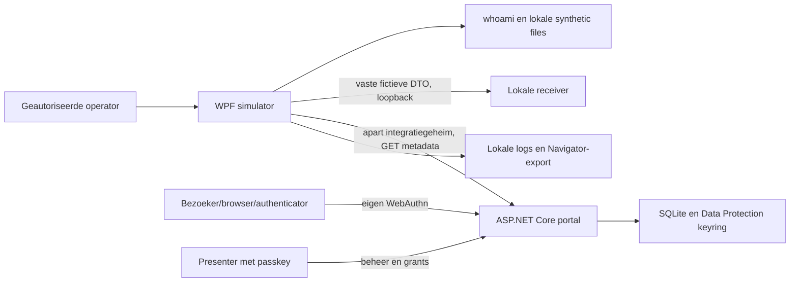

# Secure architecture - LummaSimulator

Datum: 30 oktober 2026. Huidige bron na 5.1; statische vaststellingen, geen runtime-attestatie.
[Beleid](security-requirements.md) | [dreigingen](threat-model.md) | [bewijs](security-assurance-report.md).

## Vertrouwensgrenzen en datastromen

Geen sessiecookie stroomt van browser naar WPF. Monitor-key is een apart werkelijk geheim. Diagram toont bedoelde directe appstromen; DNS, OS-/browserverkeer en configureerbare netwerkshares zijn afzonderlijke risico's, geen gemeten afwezigheid.

## Processen: volledige expliciete startinventaris

| Pad | Proces/argumenten en trigger | Beperking / risico |
| --- | --- | --- |
| LummaSimulator.App/TelemetryService.cs:107 | System-folder/whoami.exe, geen opdrachtargumenten; alleen LIVE fase 1 | Geen shell/PATH-keuze; output niet gecapteerd, maar echte identiteit zichtbaar. PID/start/end/exitcode gelogd; alleen dit child kill bij cancel |
| LummaSimulator.App/LocalTestServerManager.cs:95 | BaseDirectory/LocalTestServer/LummaSimulator.LocalTestServer.exe, gevalideerde numerieke poort en --managed; checkbox | UseShellExecute=false, vaste WorkingDirectory, private stdin, stdout/stderr gepompt; geen hash-/publishercontrole en omgeving erft parentgeheimen |
| tools/LummaSimulator.LocalTestServer/Program.cs:7 | Zelfstandige CLI met optionele poort/--managed | Bindt alleen IPv4-loopback; standalone vereist handmatig stoppen; managed stopt bij EOF/regel/parentverlies |
| tests/LummaSimulator.Web.Tests/HttpChecks.cs:43 | dotnet met afzonderlijke testweb-DLL via ArgumentList | Test-only. Eigen poort/certificaat/database; LUMMA_TEST_WEB_DLL bepaalt testtarget; niet starten in deze opdracht |
| tests/LummaSimulator.SmokeTests/LocalServerChecks.cs:80; verification/Program.cs:64 | Bestaande manager/sidecar via tests | Reële lokale subprocessen en sockets, daarom niet uitgevoerd |
| verification/Test-LocalHttpPublished.ps1:8 | Gepubliceerde helper, private stdin, testpoort | Developer-only script; geen package-/appinstaller |
| tests/LummaSimulator.RegressionTests/LummaSimulator.RegressionTests.csproj:17 | MSBuild Exec: dotnet-runners en node --test | Build-/testcode kan processen starten; alleen vertrouwde bron/toolchain, niet onderdeel van eindgebruikersfunctionaliteit |

Productieportal start in de onderzochte bron geen externe opdrachten. WPF wordt niet door portal gestart. Geen PowerShell/CMD, scriptinput, download-and-execute, plug-in-loader of remote command endpoint aangetroffen. Node-tests gebruiken node:vm voor eigen lokale JS met mocks; WPF gebruikt alleen assembly-resources via reflectie. Deze testuitvoering is geen productie-RCE.

## Bestanden en register

| Consumer | Effectieve root en acties | Controles / bewijsgrens |
| --- | --- | --- |
| LummaSimulator.App/TelemetryService.cs:31,43,187,206 | DataRoot/DemoRuns/GUID; demo-owner.txt, synthetic-browser.json, collected-data.json; CreateNew, lezen, beperkte delete en lege directory verwijderen | Absolute prefix, component-ReparsePointcheck, herkenbare marker/filenamen, geen recursieve cleanup. Geen handle-gebaseerde race-/hardlinkgarantie |
| LummaSimulator.App/Services.cs:34,38 | Logroot/run.json.tmp en run.json, directory maken, tmp schrijven, bestaande runlog atomair vervangen | Normale update tijdens run; logs blijven na Reset/Cleanup. Root is vrij configureerbaar, geen equivalente pad/ACL-check |
| LummaSimulator.App/SessionMonitorViewModel.cs:125 | Logroot/session-monitor-GUID.json; schrijven/overschrijven | Allowlist auditvelden, geen cookies/monitor-key; UUID voorkomt pathinput; rootbeleid ontbreekt |
| LummaSimulator.App/NavigatorExportService.cs:83 | Exportroot/Lumma-Demo-date-GUID-random-ATTACK.json | Allowlist DTO, geen raw logs/accountnamen/tokens; schrijfroot kan extern zijn |
| LummaSimulator.App/DesktopSettings.cs:15; shared/RuntimePaths.cs:6 | Settings naast executable lezen; environment expansion; data/log/exportroots kunnen relatief of absoluut zijn | Relatieve roots gebaseerd op BaseDirectory/DataRoot; geen local-volume/UNC/mapped-drivegrens |
| LummaSimulator.Web/Program.cs:58,74; LummaSimulator.Web/Services/DemoStore.cs:12 | Database:Path, anders DataRoot/PasskeyPortal/portal.db; SQLite en journal, sibling keys-directory | Lexicale wwwroot-prefixweigering, parameterbinding/FK/secure_delete; keyring persistent en Windows-DPAPI. Geen bewezen DACL, realpath/webroot-/sharecontrole |
| LummaSimulator.Web/Services/Prizes/PrizeMigration.cs:162 | Alleen preflight bij openen; nieuwe DDL/seeds/marker 6 transactioneel bij doelbewuste startup | Behoudtests aanwezig; niet uitvoeren op live database tijdens analyse |
| Web-services | Rijen invoegen/updaten/verwijderen voor eigen accounts, sessies, keys, challenges, statistieken en audit | Zie auth-/retentiematrix hieronder; geen browserdatabase |

**Register:** geen expliciete registry-lees-/schrijfcode, autorunkeys, services of scheduled tasks in de onderzochte eigen bron gevonden. .NET/WPF/DPAPI en OS kunnen intern register/crypto-/certificaatstores benaderen. Alleen een Procmon/ETW-run op de bedoelde release kan dat feitelijk vastleggen.

## Netwerk- en endpointinventaris

| Oppervlak | Richting, data, authenticatie | Beperking |
| --- | --- | --- |
| GET http://127.0.0.1:poort/lumma-health?nonce=... | WPF -> receiver; publieke product/protocol/nonce/instance/PID/poort | 2 KiB responsebuffer in probe; nonce+stamp is herkenning, geen cryptografische serverauthenticatie |
| POST http://127.0.0.1:poort/lumma-demo | WPF -> receiver; exacte fictieve DTO + DemoRunId | Proxy/cookies/redirects uit; receiver alleen loopback, 64 KiB totaallimiet, body <=49152, 2s timeout, exacte DTO |
| GET HTTPS origin/api/local/session-status/{runId} | WPF -> eigen portal; aparte X-Lumma-Monitor-Key; response alleen metadata | Origin alleen localhost of passkey.example.invalid; sockets alleen DNS-resultaten op loopback; TLS normaal. Server vereist loopback, key en per-demo grant |
| DNS-resolutie monitororigin | WPF -> OS-resolver | Kan netwerk veroorzaken ondanks loopback-connectfilter. Bestemmingen/fallbacks niet runtime gemeten |
| Portal HTML/static | Browser -> geconfigureerde Kestrel/proxylistener | Exacte HTTPS-authority/RP, AllowedHosts; standaard localhost-dev en passend productie-DNS. Listener/exposure blijft deploymentconfiguratie |
| /, /Demo, /Complete, /Privacy, /Error | GET publieke pagina's; POST / start account; /Demo?handler=End/NewVisitor | VisitorCookie-eigendom, Razor antiforgery, gedeelde demorequestlimiet |
| POST /api/webauthn/{register|authenticate}/{options|verify|cancel} | Browser -> eigen portal | Exact Origin, CSRF, visitorcookie en operatie-ID; geen opdrachtuitvoering |
| POST /api/language | Browser -> eigen portal | Culture/audience-allowlist, Origin/CSRF; afzonderlijke preferencecookies |
| /Presenter/Login, /Presenter/Enroll | Publieke login/enrollmentpagina's | Server-side grants/ceremonies; overige /Presenter pagina's policybeschermd |
| POST /api/presenter/enrollment/open; /api/presenter/{kind}/{options|verify|cancel} | Login/reauth/enroll; invitation-capability of bestaande sessie | Exact Origin/CSRF/rate limit; server toetst kind, browser/operatie/challengebinding, credentials en accountstatus |
| /Presenter/Index?handler=End/Logout/Monitor/Event/Rename | Beheer-POST | Presenterpolicy; afzonderlijke Actor-controle; Rename administrator-only; Monitor maakt geen tokens vrij |
| /Presenter/Accounts?handler=Create/Update/Invite/Remove; /Presenter/Audit; /Presenter/Security | Persoonlijke accounts/rollen/keys/audit | Administrator-only beheer/audit, verse herauthenticatie op gevoelige acties; eigen keyoverzicht toegestaan |
| Fido2/PKI/browser/OS | Geen MDS-provider of app-outboundservice geconfigureerd | Dependency-/OS-/passkeyproviderverkeer niet bewezen afwezig; browser sync/hybrid kan eigen verbindingen maken |
| Bestandsroots | Potentieel SMB/andere remote filesystem-I/O bij configuratie | Niet afgevangen door HttpClient-loopbackregels; SR-05/SR-13 open |

Geen Prize-REST, hub, QR-/exportendpoint of automatische prijsclaim/purge aanwezig na 5.1. De permanente publicatiecode bevat geen third-party scripts, analytics of CDN; SVG/CSS zijn lokale assets. Namespace-URL's in XAML/SVG zijn niet op zichzelf een netwerkrequest.

## Configuratieketens en materiële gevolgen

| Configuratie | Precedence/effect |
| --- | --- |
| WPF settings JSON | BaseDirectory/LummaSimulator.App.settings.json: DataDirectory, LogDirectory, ExportDirectory, PortalOrigin |
| LUMMA_DATA_DIRECTORY / LOG_DIRECTORY / EXPORT_DIRECTORY | Procesomgeving wint van overeenkomstige geconfigureerde root. Relatieve paden worden onder executable/data-root opgelost. Extern/mapped volume is niet geweigerd |
| LUMMA_PORTAL_ORIGIN / LUMMA_MONITOR_KEY | Origin override; werkelijk integratiegeheim alleen procesomgeving. Wordt niet expliciet uit childomgeving verwijderd |
| UI LIVE TELEMETRY / Local HTTP / poort | Modus en poort snapshot per run; HTTP uit bij veilige modus; readycheck vóór starten. Geen vrije host of opdrachtstring |
| Portal ASP.NET Core configuratie | appsettings en environmentvariant, development-user-secrets, environment en CLI volgens default host. ContentRoot=BaseDirectory; hosting kan listeners/certificaten wijzigen |
| Database:Path / Storage:DataDirectory | Database:Path heeft voorrang; anders gedeelde RuntimePaths-root. RP verandert niet mee met dataroot |
| WebAuthn:RpId/Origins; Experience:Hostname | Expliciete canonical HTTPS/RP-validatie; maximaal 8 origins; geen wildcard/automatische RP-omzetting |
| AllowedHosts, ASPNETCORE_URLS/Kestrel, ReverseProxy:KnownProxies | Hostinggrens, TLS en proxytrust; geen automatische firewall/DNS/certificaatinstallatie |
| Presenter:SessionMinutes | Server-timeout 5-30 minuten; cookie 30 minuten, effectief beide grenzen |
| Monitor:KeyHash | SHA-256 keyhash; zonder correcte keyhash is monitor gesloten |
| Experience:* | Organisatie/prefix/talen/idle 1-29 minuten; StartCodesRequired en PrizeEnabledByDefault true stoppen startup. StartCodeLifetimeMinutes is voorbereid, geen code-uitgifte |
| Logging:LogLevel | Consolelogging kan via hostingconfig afwijken. Request-/proxylogging moet apart op gevoelige velden worden getoetst |
| CLI --generate-monitor-key / --bootstrap-administrator | Expliciete onderhoudsacties; bootstrap controleert bestaande admin/rootrechten. Legacy password-hash/login is verwijderd/afgewezen |
| LUMMA_TEST_WEB_DLL; test directories | Alleen test-target/uitvoer. Tests mogen niet in een vrijgegeven payload of op live data worden uitgevoerd |

## Authenticatie, opslag en lifecycle

Bezoekers: willekeurig 256-bit sessiegeheim, alleen hash in SQLite, Secure/HttpOnly/Strict sessiecookie. Maximaal vijf credentials, challenge 2 minuten, UV en resident key required, attestation none, credential/account/handle/signature/counter/backupcontrole. Eigen private authenticator-key, PIN en biometrie worden niet door de applicatie gevraagd/opgeslagen.

Presentatoren: eigen PresenterKeys/Accounts/Sessions, naamloze discoverable login; aparte cookie, 30 minuten niet sliding, werkelijke sessiestatus/accountrol uit DB bij requests. Bootstrap alleen lokaal/elevated en vóór eerste geactiveerde admin; uitnodigingen 10 minuten/eenmalig; beheer vereist waar nodig verse, eenmalig gebruikte herauthenticatie. Rollen zijn niet nieuw toegevoegd door 5.1.

Visitorverwijderpaden: DemoService.OwnedCoreAsync, CleanupCoreAsync (worker/startup/dashboard/Create), EndOwnAsync, EndAsPresenterAsync, Create(previous) sluit/revoket; SessionStatusService.GetAsync:73 verwijdert ook bij idle. Credentials/challenges/grants cascaderen. Historische VisitorCounts.DemoId wordt NULL, aggregate statistieken blijven. Presenteraccounts/keys/audit blijven tot expliciet toekomstig beheer; geen volledige retentiepolicy geïmplementeerd.

5.1: interne PrizeStore controleert Actor in dezelfde IMMEDIATE-transactie, disabled Drafts, exact payloadvergelijking+SHA-256/idempotentie, CAS en samengestelde event-FK's. Dit is geen beveiligde deelnemers-/claimfunctionaliteit; lifecycle- en bedrijfsregels moeten vóór 5.2-activering volledig worden aangesloten.

## Windows/native API-classificatie

Expliciete native import: alleen libc.geteuid op Linux voor onderhoudsrechten. Windows gebruikt WindowsIdentity.GetCurrent/WindowsPrincipal.IsInRole en Data Protection ProtectKeysWithDpapi. Process.Start/WaitForExit/Kill, File/Directory/GetAttributes/ReparsePoint, .NET sockets/Dns en WPF input/commands zijn managed wrappers op OS-functies. Exacte indirecte Win32/DLL-aanroepen zijn zonder runtime/native analyse onbekend; geen verzonnen volledige Win32-calllijst.

Geen bronbewijs gevonden voor keyboardhooks, procesinjectie, memorydumping, LSASS-/browserdecryptie, service-/taskinstallatie, Defenderwijzigingen, privilege-exploit of remote opdrachtparser. Afwezigheid van bronhits is geen bewijs over iedere native dependency of onbekende aangepaste binary.
